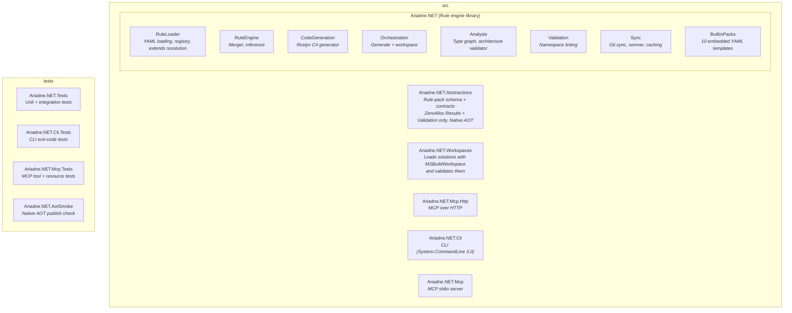
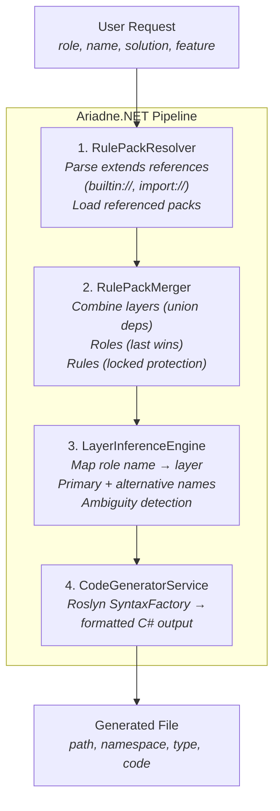
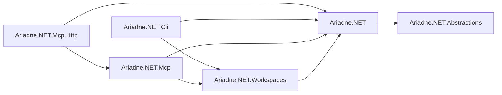
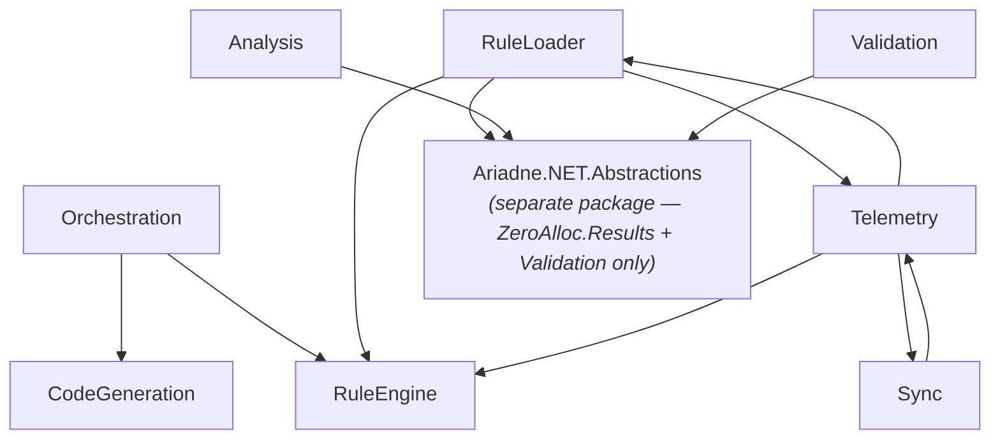

# Architecture

## Solution Structure

## Core Pipeline

The engine processes a user request through a series of stages:

Validation is a separate path. `ISolutionValidator` in `Ariadne.NET.Workspaces` loads a solution into compilations, and `IArchitectureValidator` in `Ariadne.NET` builds a type graph per compilation and checks it against the resolved pack. See [Validation and Linting](08-validation.md).

## Dependency Flow

The CLI and the MCP hosts depend on `Ariadne.NET.Workspaces`, which depends on `Ariadne.NET`, which depends on `Ariadne.NET.Abstractions`. Abstractions holds the rule-pack schema and the loader, resolver and registry contracts, and depends on nothing, so other tools can reference it without pulling in Roslyn or YamlDotNet. The only host-to-host dependency is `Ariadne.NET.Mcp.Http` → `Ariadne.NET.Mcp`, so the HTTP transport serves the same MCP tools and resources as stdio.

Within `Ariadne.NET`, the namespaces depend on each other as follows. `Analysis` and `Validation` depend only on Abstractions, and `Telemetry` holds the instrumented pack and sync interfaces, so the pack and sync code and `Telemetry` reference each other.

---

