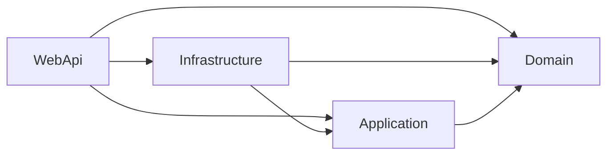

# Rule Schema

A rule pack is a YAML file in a strict, versioned format called schema 2. It says which types each layer covers, which dependencies are forbidden or restricted, and why. This page describes the format and the C# model it loads into. If you have a pack from release 0.3.0 or earlier, read [Migrating from v1](#migrating-from-v1) at the end of this page.

The models are sealed classes with `required` properties and sensible defaults, using `IList<T>` in public APIs (per analyzer rule MA0016).

## A pack at a glance

```yaml
schema: 2
name: daedalus
version: "1.0.0"
author: daedalus-team
extends:
  - builtin://clean-architecture

layers:
  - name: Domain                      # inherited: only the selectors may change
    assemblies: [Daedalus.Domain]
  - name: Agents
    id: DAEDALUS-LAYER-AGENTS
    because: Agents orchestrate use cases; they never reach into the API.
    assemblies: [Daedalus.Agents]
    allowedDependencies: [Domain, Application]

rules:
  - id: DAEDALUS-NO-EFCORE-IN-DOMAIN
    because: Persistence belongs to Infrastructure.
    forbid:
      from: { layers: [Domain] }
      to: { namespaces: ["Microsoft.EntityFrameworkCore.**"] }
  - id: DAEDALUS-RAGNET-ONLY-IN-AGENTS
    because: Retrieval is an agent concern.
    allowOnly:
      from: { layers: [Agents] }
      to: { assemblies: ["Rag.NET*"] }

componentRoles:
  - name: Entity
    layer: Domain
    typeKind: Class

namingConventions:
  namespace: "{SolutionName}.{Feature}.{Layer}"
  filePath: "src/{SolutionName}.{Feature}.{Layer}/{ComponentName}.cs"
```

## Top-level keys

Every mapping in a pack has a closed set of keys. An unknown key, a missing required key or a value of the wrong type fails the load; see [Load errors](#load-errors).

| Key | Required | Meaning |
|-----|----------|---------|
| `schema` | yes | Must be the integer `2`. Without it the load fails with a message that links to [Migrating from v1](#migrating-from-v1). |
| `name` | yes | Pack name. |
| `version` | no | The pack author's own version, default `"1.0.0"`. Unrelated to `schema`. |
| `author` | no | Pack author or maintainer, default `""`. |
| `extends` | no | Parent pack references: `builtin://name` or `import://name`. See [`extends`](#extends). |
| `layers` | no | List of layers. |
| `rules` | no | List of `forbid`, `allowOnly`, `require`, `bannedPackages` and `uniqueNames` rules. |
| `componentRoles` | no | List of component roles, used for code generation and role checks. |
| `namingConventions` | no | Templates for namespaces and file paths. |

The v1 section for code feature rules is not part of schema 2. A pack that still has it fails with `'codeFeatureRules' is not part of schema 2; typed code-feature rules arrive in a later release`.

The C# model is `RulePack`:

| Property | Type | Default |
|----------|------|---------|
| `Name` | `string` | *(required)* |
| `Schema` | `int` | `2` |
| `Version` | `string` | `"1.0.0"` |
| `Author` | `string` | `""` |
| `Extends` | `IList<string>` | `[]` |
| `Layers` | `IList<LayerDefinition>` | `[]` |
| `Rules` | `IList<RuleDefinition>` | `[]` |
| `ComponentRoles` | `IList<ComponentRoleDefinition>` | `[]` |
| `NamingConventions` | `NamingConventions` | `new()` |

`RulePack` also carries `LayerRetargets` and `RuleAmendments`. They hold the child-pack entries that `extends` merging consumes (see below) and are empty on a resolved pack.

## Layers

A layer says which types it covers and which other layers those types may depend on.

| Key | Required | Meaning |
|-----|----------|---------|
| `name` | yes | Unique in the merged pack. Names compare case-insensitively when other keys refer to them. Referenced by `allowedDependencies`, rule targets and roles. |
| `id` | yes, unless the entry retargets an inherited layer | The rule id that layer-dependency violations carry. Unique across all layer and rule ids in the merged pack. |
| `because` | yes, same exception | Why the layer may depend only on what it lists. Repeated on every violation. |
| `description` | no | Free text. |
| `namespaces`, `assemblies` | at least one, same exception | [Selectors](#selectors) that say which types the layer covers. |
| `allowedDependencies` | no, default `[]` | Names of the layers this layer may depend on. |

Layer selectors take `namespaces` and `assemblies` only, not `types`. They apply to types from referenced assemblies as well as to source types, so a layer can cover external code by assembly.

An empty `allowedDependencies` makes the layer a leaf: it depends on no other layer.

**How the engine checks a layer.** For every dependency from a type in layer L to a type in layer M, with M different from L and not in L's `allowedDependencies`, the engine reports `DependencyNotAllowed` with L's `id` and `because`. The check is open-world:

- A dependency on a type that no layer covers is not checked.
- A type that no layer covers is not a source, so nothing is checked for it.
- A type that two or more layers cover is reported once as `LayerOverlap`, naming the layers, and takes no part in the dependency check, so one pack mistake does not turn into a list of false dependency violations. There is no precedence between layers. For example, `Shop.Application.Domain` is covered by both `**.Application.**` and `**.Domain.**` of the built-in clean-architecture pack; the pack author resolves it by retargeting a layer. A `LayerOverlap` violation fails `validate` like any other. Its rule id is the ids of the covering layers joined with `+`.

**Dependency graph example (Clean Architecture):**



```yaml
layers:
  - name: Domain
    id: CA-LAYER-DOMAIN
    because: The domain is the core of the architecture and depends on no other layer.
    namespaces: ["**.Domain.**"]
    allowedDependencies: []
  - name: Application
    id: CA-LAYER-APPLICATION
    because: Use cases orchestrate the domain and reach outward only through interfaces they own.
    namespaces: ["**.Application.**"]
    allowedDependencies: [Domain]
```

The C# model is `LayerDefinition`:

| Property | Type | Default |
|----------|------|---------|
| `Name` | `string` | *(required)* |
| `Id` | `string` | `""` |
| `Because` | `string` | `""` |
| `Description` | `string` | `""` |
| `Namespaces` | `IList<string>` | `[]` |
| `Assemblies` | `IList<string>` | `[]` |
| `AllowedDependencies` | `IList<string>` | `[]` |

## Rules

A rule is an entry in `rules:`. It has exactly one of `forbid`, `allowOnly`, `require`, `bannedPackages` or `uniqueNames`.

| Key | Required | Meaning |
|-----|----------|---------|
| `id` | yes | Unique across all layer and rule ids of the merged pack. |
| `because` | yes | Why the rule exists. Repeated on every violation. |
| `description` | no | Free text. |
| `forbid` | one of | `{ from: <target>, to: <target> }`: no type in `from` may depend on a type in `to`. Reported as `ForbiddenDependency`. |
| `allowOnly` | one of | `{ from: <target>, to: <target> }`: a type in `to` may be depended on only by types in `from`, or by types in `to` itself. Any other source is reported as `DependencyNotPermitted`. |
| `require` | one of | `{ for: <selector>, layer, kind, accessibility, implements }`: every type that `for` selects must satisfy the requirement. At least one of `layer`, `kind`, `accessibility` and `implements` is needed. See [Require rules](#require-rules). |
| `bannedPackages` | one of | `{ packages: [...], from: { assemblies: [...] } }`: no project in `from` may resolve a package that `packages` matches. Reported as `BannedPackage`. See [Banned packages](#banned-packages). |
| `uniqueNames` | one of | `{ for: <target>, against: <target> }`: no type in `for` may share a simple name with a type in `against`. Reported as `NameCollision`. See [Unique names](#unique-names). |
| `exceptions` | no | List of selectors, each with a required `because`. A source type that an exception matches is exempt from the rule. On a `bannedPackages` rule an exception takes `assemblies` only, and on a `uniqueNames` rule `namespaces` and `types` only. |
| `locked` | no, default `false` | A child pack cannot add exceptions to this rule. |

A **target** is either `layers: [...]` or a [selector](#selectors) made of `namespaces`, `assemblies`, `types`, `baseTypes`, `interfaces` and `attributes`. Mixing `layers` with selector kinds in one target is a load error, and a target must select something.

An exception takes `namespaces`, `assemblies` and `types` (at least one) and a required `because`. Exceptions exempt the source type, the same way for `forbid` and `allowOnly`.

Both kinds of rule apply regardless of layers: a `forbid` between two types of the same layer still fires. As with layers, the engine reports one violation per rule, source type and target type, located at the first reference, with the number of references. Each carries the rule's `id` and `because`.

```yaml
rules:
  - id: DAEDALUS-SUBAGENT-RUNNER
    because: Subagents start only through the executor, which records the run.
    allowOnly:
      from: { types: [Daedalus.Application.Agents.SubagentRunExecutor] }
      to: { types: [Daedalus.Application.Agents.ISubagentRunner] }
    exceptions:
      - types: [Daedalus.Infrastructure.Agents.SubagentRunner]
        because: The implementation must name its interface.
      - types: [Daedalus.Api.Composition.AgentRegistration]
        because: DI registration wires the interface to its implementation.
```

The C# model is `RuleDefinition`, with `Id`, `Because`, `Description`, `Kind` (`RuleKind.Forbid`, `RuleKind.AllowOnly`, `RuleKind.Require`, `RuleKind.BannedPackages` or `RuleKind.UniqueNames`), `From` and `To` (`TargetSelector`), `Require` (`RuleRequirement?`, with `Layer`, `Kind`, `Accessibility` and `Implements`), `Packages` (`IList<string>`), `Against` (`TargetSelector`), `Exceptions` (`IList<RuleException>`) and `Locked`. For a `require` or `uniqueNames` rule `From` holds the `for` selector, and for a `bannedPackages` rule it holds `from`.

### Require rules

A `forbid` or `allowOnly` rule constrains dependencies. A `require` rule constrains where a type lives and what shape it has. `for` is a [selector](#selectors) and the other keys describe what each selected type must be:

| Key | Meaning | Reported as |
|-----|---------|-------------|
| `layer` | The name of the layer the type must belong to. | `WrongLayer` |
| `kind` | `class`, `interface`, `record`, `struct` or `recordStruct`. | `TypeKindMismatch` |
| `accessibility` | `public` or `internal`. Only `internal` is checked, because public is the default. | `AccessibilityMismatch` |
| `implements` | A selector with `namespaces`, `assemblies` and `types` only. The type must implement an interface it matches, including interfaces it gets through a base class. | `MissingInterface` |

Placement example: every implementation of a repository interface lives in Infrastructure, as an internal class.

```yaml
rules:
  - id: SHOP-REPOSITORIES-IN-INFRASTRUCTURE
    because: Persistence is an infrastructure concern, and callers use the interface.
    require:
      for: { interfaces: ["**.I*Repository"] }
      layer: Infrastructure
      kind: class
      accessibility: internal
    exceptions:
      - namespaces: ["**.Domain.**"]
        because: The repository interfaces themselves live in the domain.
      - types: ["Shop.Testing.InMemoryOrderRepository"]
        because: Test doubles live next to the tests.
```

`interfaces` selects a type that implements a matching interface, and that includes an interface that extends one. `interface IOrderRepository : IRepository<Order>` is therefore selected by `**.I*Repository` too, and without the Domain exception it would be reported as `WrongLayer`, `TypeKindMismatch` and `AccessibilityMismatch`.

A `require` rule yields one violation per selected type and failed requirement, with the rule's `id` and `because`. Exceptions exempt a type, and a rule with no match checks nothing.

### Banned packages

A `bannedPackages` rule bans packages from the resolved package graph of a project. `packages` is a required, non-empty list of package-id patterns, and `from` optionally limits the rule to projects by `assemblies`; any other key in `from` is a load error, because a package belongs to a project and not to a type.

```yaml
rules:
  - id: SHOP-NO-NEWTONSOFT-JSON
    because: JSON goes through System.Text.Json.
    bannedPackages:
      packages: ["Newtonsoft.Json", "FluentValidation*"]
      from: { assemblies: ["Shop.Domain", "Shop.Application"] }
```

Package ids match case-insensitively, since NuGet ids do, with the `*` rules of `types`. Transitive packages count, including a package that arrives through a referenced project, and the violation names the path from the direct reference. A violation is one per project and package, with `SourceType` the project name and `Target` the package id. The packages come from `obj/project.assets.json`, so the project must be restored. When a covering rule meets a project whose packages are unknown, the run fails and does not report a clean result.

### Unique names

A `uniqueNames` rule keeps a type from reusing the name of another type. `for` and `against` are both required and take every selector key. A type in `for` that has the same simple name as a type in `against` is one violation, located at the `for` type, with the other type as `Target`.

```yaml
rules:
  - id: SHOP-WEB-OWN-NAMES
    because: Web maps to its own view models and never copies an application DTO.
    uniqueNames:
      for: { layers: [Web] }
      against: { namespaces: ["Shop.Application.**.Dtos"] }
```

The check is one-way: it reports the `for` type only. It compares the simple name case-sensitively, ignores the namespace and counts generic arity, so `Result` and `Result<T>` differ. A nested type uses its own name, a type in both selections never collides with itself, and the types of all projects of the run are compared.

### Members

`members` is a selector key on the `to` side of `forbid` and `allowOnly`. It names APIs at member level: methods, constructors, properties, fields and events. The loader rejects it on `from`, on layers and on exceptions.

```yaml
rules:
  - id: SHOP-SQL-ONLY-IN-INFRASTRUCTURE
    because: Raw SQL stays behind the repositories.
    allowOnly:
      from: { layers: [Infrastructure] }
      to: { members: ["System.Data.Common.DbCommand.Execute*", "Microsoft.Data.SqlClient.SqlCommand.new"] }
```

A pattern is `Namespace.Type.Member` with the glob rules of `types`: the segments before the last name the type, the last segment names the member. `new` names a constructor, nested types are written with dots, and generic types match without type arguments. A use matches when the used member, or a member it overrides or implements, matches a pattern, so calling `SqlCommand.ExecuteReader()` matches `DbCommand.ExecuteReader`. The walk goes upwards only. Calls, constructor calls, property and field reads and writes, event subscriptions and method groups count as uses; declaring a member does not. A `to` selector with `members` is checked on member uses only, and its other keys test the used member's declaring type. Under `allowOnly` the declaring type and the types nested in it are exempt. Violations are `ForbiddenDependency` and `DependencyNotPermitted`, with the used member as `Target`.

## Selectors

A selector has up to eight lists: `layers`, `namespaces`, `assemblies`, `types`, the three code-feature keys below and `members` (see [Members](#members)). Values within one list are alternatives: any may match. When a selector has more than one list, a type must match each list it has. So `{ assemblies: [Daedalus.Agents], namespaces: ["**.Api.**"] }` means the Api namespaces inside the Agents assembly. A selector with no values is a load error.

Matching is ordinal and case-sensitive, like C# names.

- **`namespaces`** match a type's containing namespace, split on `.` into segments. A segment that is exactly `**` matches zero or more segments. `*` inside a segment matches any characters within that segment, so `*` alone matches exactly one segment and `EntityFrameworkCore*` matches a segment that starts with that text. `**` anywhere else in a segment is a load error. `**.Domain.**` matches `Domain`, `Shop.Domain` and `Shop.Domain.Orders`. The global namespace is the empty string and matches only `**`.
- **`assemblies`** match the containing assembly name as one string, where `*` matches any characters, dots included. `Rag.NET*` matches `Rag.NET` and `Rag.NET.Abstractions`.
- **`types`** match the type's full name: namespace and containing types joined with `.`, without generic arity or type arguments. They use the namespace rules with the type name as the last segment. `Daedalus.Application.Agents.ISubagentRunner` names one type; `**.I*Repository` names every repository interface. A generic type `Foo<T>` is matched as `Foo`.

- **`baseTypes`** match any type in the base class chain of a type, with the `types` grammar. `**.RepositoryBase` selects every class that derives from a `RepositoryBase`, directly or not. A generic base is matched without its type arguments.
- **`interfaces`** match any interface a type implements or inherits, directly or through a base class, with the `types` grammar. `**.I*Repository` selects every implementation of a repository interface.
- **`attributes`** match the full name of an attribute on the type, with the `types` grammar. Write the name as the compiler knows it, so `**.ObsoleteAttribute` and not `**.Obsolete`.

The three keys work in the `for` of a `require` rule and in the targets of `forbid` and `allowOnly`. Like `namespaces`, `assemblies` and `types`, they cannot be mixed with `layers` in one target.

An empty pattern, or one with an empty segment such as `Shop..Domain`, is a load error.

`TargetSelector` has `Layers`, `Namespaces`, `Assemblies`, `Types`, `BaseTypes`, `Interfaces`, `Attributes` and `Members`. `RuleException` has `Namespaces`, `Assemblies`, `Types` and a required `Because`.

## `extends`

`extends` lists parent packs: `builtin://name` for an embedded pack and `import://name` for a pack fetched by `ariadne sync`. Packs merge parent first, in `extends` order, then the child. See [Rule Loading](04-rule-loading.md) for how the references resolve and [Rule Engine](05-rule-engine.md) for the merge.

`extends` is not recursive: only the packs a pack lists are loaded, and a parent's own `extends` is ignored. List every pack you need in the pack that you resolve.

A child pack may do three things to what it inherits:

- **Retarget a layer.** A layer entry with an inherited `name` that has only `name`, `namespaces` and `assemblies` replaces the inherited selectors. It cannot change `allowedDependencies` or `because`. A layer entry with any other key and an inherited name is a conflict and fails the load.
- **Add rules.** A new `id` adds a rule. It must be a full rule.
- **Add exceptions.** A rule entry with an inherited `id` that has only `id` and `exceptions` appends those exceptions. Adding exceptions to a `locked` rule fails the load.

Two parents that define the same layer name or rule id fail the load, naming both packs. There is no last-one-wins for layers and rules. A solution picks one base architecture and retargets it. Role-only packs such as `cqrs` and `ddd-tactical` define no layers, so they compose with any base pack that has the layers their roles name; see [Built-in Templates](12-builtin-templates.md#composing-templates).

Component roles merge by name, case-insensitively, and the last role with a name wins. The last pack's `namingConventions` wins.

## ComponentRoleDefinition

A role maps a role name to a layer, a C# type kind, an accessibility and an interface requirement. Roles drive code generation and the role checks of `validate`. Their keys are `name`, `layer`, `typeKind`, `requiresInterface`, `interfaceRole`, `accessibility`, `description` and `alternativeNames`, and the loader checks them as strictly as the rest of the pack. `layer` must name a layer of the merged pack, once that pack has at least one layer.

| Property | Type | Default | Description |
|----------|------|---------|-------------|
| `Name` | `string` | *(required)* | Role identifier (e.g., `"Entity"`, `"Repository"`) |
| `Layer` | `string` | *(required)* | The architectural layer this role belongs to |
| `TypeKind` | `CSharpTypeKind` | `Class` | C# type: `Class`, `Interface`, `Record`, `Struct`, `RecordStruct`; any other value is a load error |
| `RequiresInterface` | `bool` | `false` | Whether the implementation must have a corresponding interface |
| `InterfaceRole` | `string?` | `null` | Name of the paired interface role definition |
| `Accessibility` | `string` | `"public"` | Access modifier: `public`, `internal`, `private`, `protected`, `protected internal`, `private protected` |
| `Description` | `string` | `""` | Purpose and usage guidance |
| `AlternativeNames` | `IList<string>` | `[]` | Aliases for role matching (used by the layer inference engine) |

**Interface pairing pattern:**

Roles often come in pairs — an interface definition in one layer and an implementation in another. This enforces the Dependency Inversion Principle:

```yaml
# Contract in Domain layer (public interface)
- name: RepositoryInterface
  layer: Domain
  typeKind: Interface
  accessibility: public
  alternativeNames: [Repository]

# Implementation in Infrastructure layer (internal class)
- name: Repository
  layer: Infrastructure
  typeKind: Class
  requiresInterface: true
  interfaceRole: RepositoryInterface
  accessibility: internal
```

When generating a `Repository`, the engine knows:
- The class goes in `Infrastructure` (from `layer`)
- It must be `internal` (from `accessibility`)
- It must implement `IOrderRepository` (from `requiresInterface` + `interfaceRole`)

## NamingConventions

Template strings for namespace and file path resolution, using four substitution variables. The templates are not validated beyond being non-empty.

| Property | Type | Default | Description |
|----------|------|---------|-------------|
| `Namespace` | `string` | `"{SolutionName}.{Feature}.{Layer}"` | C# namespace template |
| `FilePath` | `string` | `"src/{SolutionName}.{Feature}.{Layer}/{ComponentName}.cs"` | Output file path template |

**Template variables:**

| Variable | Source | Example |
|----------|--------|---------|
| `{SolutionName}` | User input | `MyApp` |
| `{Feature}` | User input | `Orders` |
| `{Layer}` | Inferred from role | `Domain` |
| `{ComponentName}` | User input | `Order` |

**Resolution example:**

```
Template:  {SolutionName}.{Feature}.{Layer}
Input:     SolutionName=MyApp, Feature=Orders, Role=Entity → Layer=Domain
Result:    MyApp.Orders.Domain
```

## CSharpTypeKind

Enum mapping to C# type declarations:

| Value | C# Output | Roslyn Factory |
|-------|-----------|----------------|
| `Class` | `public class Order { }` | `SyntaxFactory.ClassDeclaration()` |
| `Interface` | `public interface IOrderRepository { }` | `SyntaxFactory.InterfaceDeclaration()` |
| `Record` | `public record OrderCreated;` | `SyntaxFactory.RecordDeclaration()` |
| `Struct` | `public struct Money { }` | `SyntaxFactory.StructDeclaration()` |
| `RecordStruct` | `public record struct Coordinate;` | `SyntaxFactory.RecordDeclaration()` with `StructKeyword` |

## Load errors

The loader collects every problem in a file and then fails once. Each problem has the file path, the line and the column of the offending node, and a message in pack terms:

```text
.architecture/rules.yaml:12:5: unknown key 'allowedDependancies' in layer 'Core'; did you mean 'allowedDependencies'?
.architecture/rules.yaml:20:3: rule 'NO-EFCORE' has no 'because'
.architecture/rules.yaml:1:1: 'schema: 2' is required; this looks like a v1 pack. See https://marcelroozekrans.github.io/Ariadne.NET/how-it-works/rule-schema#migrating-from-v1
```

The result is an `AriadneError` with code `Invalid`. Its message gives the count, such as `Rule pack file '.architecture/rules.yaml' has 3 problem(s).`, and its detail lists one problem per line. Lines and columns start at 1. A pack loaded from a string uses `rule pack YAML` in place of the file path.

The reader checks, in one pass: unknown keys (with a did-you-mean when an allowed key is within edit distance 2), duplicate keys, missing required keys, values of the wrong type, empty selectors and invalid patterns. When `schema` is missing or is not `2`, that is the only problem reported, because the rest of the file has another meaning.

Checks that need the whole pack run after the merge: unknown layers in `allowedDependencies`, rule targets and roles; duplicate layer, role and rule ids; an empty layer or rule id, which only a pack built in code can have; layers or rules defined by two packs; retargets and amendments of things no parent defines; and amendments of locked rules.

## Migrating from v1

Schema 2 is a clean break. The loader reads only schema 2 packs; there is no v1 compatibility mode and no converter. A pack from release 0.3.0 or earlier needs these edits:

1. **Add `schema: 2`** at the top of the file, and give the pack a `name`. Schema 2 requires both.
2. **Give each layer an `id`, a `because` and selectors.** In v1 a type belonged to a layer when one segment of its namespace equalled the layer name. In schema 2 the layer lists what it covers with `namespaces` globs, `assemblies` names, or both:

   ```yaml
   # v1
   layers:
     - name: Domain
       allowedDependencies: []

   # schema 2
   layers:
     - name: Domain
       id: SHOP-LAYER-DOMAIN
       because: The domain depends on no other layer.
       namespaces: ["**.Domain.**"]
       allowedDependencies: []
   ```

   The built-in packs use selectors of the form `**.<Segment>.**`, which match the same namespaces as v1 did. One difference: v1 resolved nested matches by the innermost segment, so `Shop.Application.Domain` was in `Domain` in v1. Both `**.Application.**` and `**.Domain.**` cover it now, so it is a `LayerOverlap`.

   A pack that extends a built-in pack and defines its own layers with the same names as the parent's no longer works, because two definitions of one layer conflict. Keep the inherited layer and retarget it instead: list the name with only `namespaces` or `assemblies`.
3. **Drop the `codeFeatureRules` section.** Schema 2 has no such key, and nothing evaluated the v1 entries beyond two checks that the engine already runs from the component roles. Typed code-feature rules arrive in a later release. Dependency restrictions that you wrote as prose can now be written as `forbid` and `allowOnly` rules.
4. **Globs are case-sensitive.** v1 compared layer names with namespaces ignoring case. Selectors compare ordinally, like C# names, so `**.domain.**` does not match `Shop.Domain`.
5. **Composing two layer-defining built-in packs now fails.** `clean-architecture+microservice` used to merge layers by name and union their dependencies. Now it fails with a message such as `packs 'clean-architecture' and 'microservice' both define layer 'Domain'`. Pick one base architecture and retarget its layers. Role-only packs such as `cqrs` and `ddd-tactical` still compose with a base pack.
6. **`lint` is gone.** The `ariadne lint` command and the `lint_source` MCP tool are removed, together with `ILinter`. They compared one namespace segment with a directory name, which selectors replace. Use `ariadne validate`, which checks layers, rules and roles on the compiler's semantic model.

Everything else in a v1 pack keeps its shape: `componentRoles` and `namingConventions` use the same keys, now checked strictly. A typo that v1 silently dropped, such as `allowedDependancies`, is now an error with a line and column.
