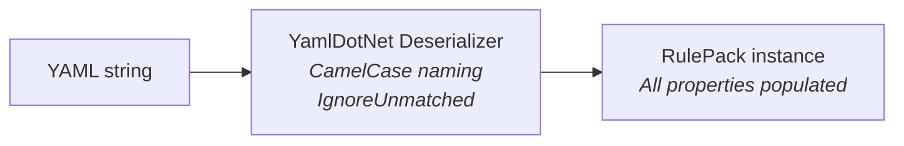
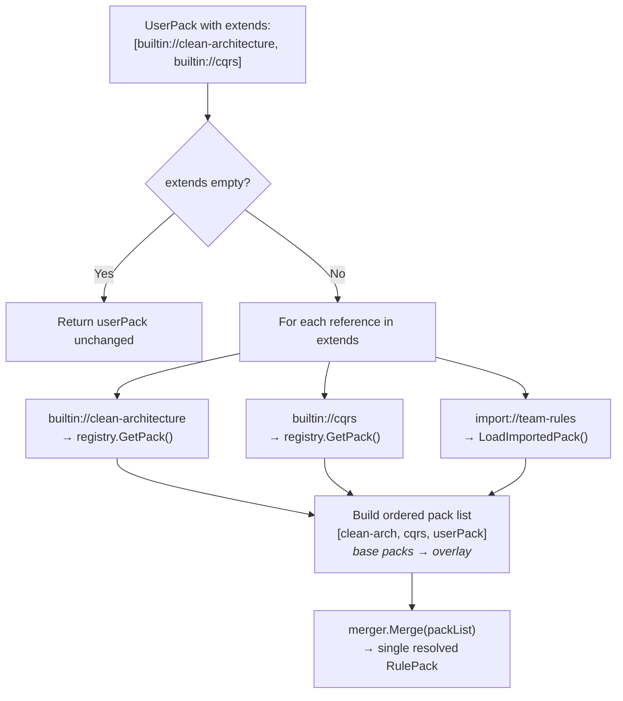

# Rule Loading Pipeline

The loading pipeline transforms YAML text into resolved, merged `RulePack` objects ready for use by the engine.

## YamlRulePackLoader

**Interface:** `IRulePackLoader`
**Implementation:** `YamlRulePackLoader`

Deserializes YAML into `RulePack` instances using YamlDotNet.

```
IRulePackLoader
  ├── LoadFromString(string yaml) → Result<RulePack, AriadneError>
  └── LoadFromFile(string filePath) → Result<RulePack, AriadneError>
```

**Deserialization configuration:**
- `CamelCaseNamingConvention` — maps `camelCase` YAML keys to `PascalCase` C# properties
- `IgnoreUnmatchedProperties()` — extra YAML keys don't cause errors (forward-compatible)

**Failures** come back as an `AriadneError`, never as an exception. `LoadFromFile` names the file in the message:
- malformed YAML: `Invalid`, with the parser's reason in the message and Detail `line {n}, column {n}`
- YAML of the wrong shape: `Invalid` ("… does not match the rule pack schema."), with the location in Detail
- an empty document: `Invalid` ("Rule pack YAML is empty." or "Rule pack file '{path}' is empty.")
- a missing file: `NotFound`, with the path in Detail
- a file that cannot be read: `Unavailable`, with the OS message in Detail

**Flow:**



## BuiltinPackRegistry

**Interface:** `IBuiltinPackRegistry`
**Implementation:** `BuiltinPackRegistry`

Discovers and loads built-in YAML packs embedded as assembly resources.

```
IBuiltinPackRegistry
  ├── GetAvailablePackNames() → IReadOnlyList<string>
  └── GetPack(string name) → RulePack
```

**Discovery algorithm (constructor):**

1. Scans all manifest resource names in the `Ariadne.NET` assembly
2. Filters for names containing `"BuiltinPacks"` and ending with `".yaml"`
3. Extracts pack names from resource paths:
   - `Ariadne.NET.BuiltinPacks.clean-architecture.yaml` → `clean-architecture`
   - Algorithm: strip `.yaml`, take the segment after the last `.` before the extension
4. Builds a `Dictionary<string, string>` mapping pack names to resource names

**Pack loading (GetPack):**

1. Check in-memory cache first (protected by `Lock` for thread safety)
2. If not cached: validate the name exists in the resource map
3. Load the embedded resource stream from the assembly
4. Read the stream as a UTF-8 string
5. Deserialize via `YamlRulePackLoader.LoadFromString()`
6. Store in cache and return
7. Returns a `NotFound` error naming the pack, with the available packs in Detail, if the name is unknown

**Thread safety:** Uses .NET 9+ `Lock` type (not `object` + `Monitor`) for the cache dictionary.

## RulePackResolver

**Interface:** `IRulePackResolver`
**Implementation:** `RulePackResolver`

Resolves `extends` references in a user pack, loads all referenced packs, and merges them into a single resolved `RulePack`.

```
IRulePackResolver
  ├── Resolve(RulePack userPack) → Result<RulePack, AriadneError>
  └── Resolve(RulePack userPack, string? workingDirectory) → Result<RulePack, AriadneError>
```

**Reference schemes:**

| Scheme | Example | Resolution |
|--------|---------|------------|
| `builtin://` | `builtin://clean-architecture` | Loaded from `IBuiltinPackRegistry` |
| `import://` | `import://company-standards` | Loaded from `.architecture/.cache/git/{name}/` |

Any other scheme returns an `Invalid` error. Resolution stops at the first reference that fails and returns its error.

**Resolution algorithm:**



**Import loading (LoadImportedPack):**

1. Requires a working directory (an `Invalid` error if null)
2. Constructs cache path: `{workingDirectory}/.architecture/.cache/git/{importName}/`
3. Validates the cache directory exists and holds a YAML file (a `NotFound` error telling the user to run `ariadne sync` if not)
4. Finds the first `.yaml` file in the cache directory
5. Loads via `_loader.LoadFromFile()`

---

