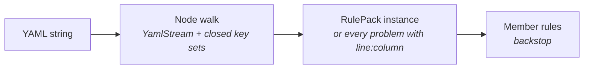
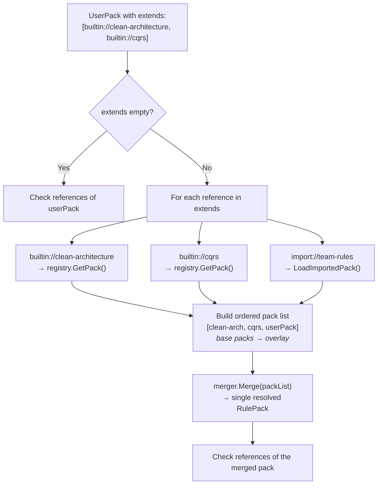

# Rule Loading Pipeline

The loading pipeline transforms YAML text into resolved, merged `RulePack` objects ready for use by the engine.

## YamlRulePackLoader

**Interface:** `IRulePackLoader`
**Implementation:** `YamlRulePackLoader`

Reads a schema 2 pack from YAML. The reader parses the text with YamlDotNet's representation model (a node tree with line and column marks) and walks it by hand into the `RulePack` model, so every problem can be reported with its position. It does not use YamlDotNet's object deserializer, and it does not ignore unknown keys.

```
IRulePackLoader
  ├── LoadFromString(string yaml) → Result<RulePack, AriadneError>
  └── LoadFromFile(string filePath) → Result<RulePack, AriadneError>
```

**Reading rules:**
- every mapping has a closed set of keys; an unknown key is a problem, with a did-you-mean when an allowed key is within edit distance 2
- a repeated key in one mapping is a problem
- `schema: 2` and `name` are required; each layer, rule and exception has its own required keys (see [Rule Schema](03-rule-schema.md))
- values must have the right type, selectors must hold at least one value, and every glob must compile
- a leading byte order mark is ignored, and LF and CRLF files give the same positions
- anchors and aliases resolve; a problem in a node that several aliases reach is listed once

**Limits.** A pack may nest mappings and sequences at most 32 levels deep, counting the top-level mapping as one; deeper nesting is one problem, "the pack nests deeper than 32 levels", at the collection that crosses the limit. One read visits at most 100,000 entries, and a node reached again through an alias counts again; a pack that expands beyond that is one problem, "the pack expands to more than 100000 entries", at the entry where the budget ran out, and reading stops there. Both limits sit far above any real pack and keep a hostile pack from exhausting the stack or memory. Text from the pack that a message quotes, such as a key, a name or a pattern, is cut to 80 characters with `...`, and so is a YAML syntax message, which can quote an anchor name. Control characters, format characters such as a right-to-left override, line and paragraph separators and lone surrogates are shown escaped, such as `\u001b`.

**Failures** come back as an `AriadneError`, never as an exception. `LoadFromFile` names the file in the message:
- malformed YAML: `Invalid`, one problem at the parser's position
- a pack the reader rejects: `Invalid` ("Rule pack file '{path}' has {n} problem(s)." or "Rule pack YAML has {n} problem(s)."), with one `<location>:<line>:<column>: <message>` line per problem in Detail, in document order. Every problem in the file is listed, not only the first. `<location>` is the file path, or `rule pack YAML` for a string
- an empty document: reported as the problem "the pack is empty"
- a missing file: `NotFound`, with the path in Detail
- a file that cannot be read: `Unavailable`, with the OS message in Detail
- a pack with no `schema` key: one problem, "'schema: 2' is required; this looks like a v1 pack", with a link to [Migrating from v1](03-rule-schema.md#migrating-from-v1)

**Member rules** run after the reader succeeds, on each pack on its own, as a backstop for callers that build a `RulePack` in code: non-empty names, ids and `because` text, a defined `typeKind` and rule kind, and no null entry in any list. A broken member rule is `Invalid` ("Rule pack '{name}' is invalid."), with one `path: reason` line per failure in Detail.

**Flow:**



## BuiltinPackRegistry

**Interface:** `IBuiltinPackRegistry`
**Implementation:** `BuiltinPackRegistry`

Discovers and loads built-in YAML packs embedded as assembly resources.

```
IBuiltinPackRegistry
  ├── GetAvailablePackNames() → IReadOnlyList<string>
  └── GetPack(string name) → RulePack
```

**Discovery algorithm (constructor):**

1. Scans all manifest resource names in the `Ariadne.NET` assembly
2. Filters for names containing `"BuiltinPacks"` and ending with `".yaml"`
3. Extracts pack names from resource paths:
   - `Ariadne.NET.BuiltinPacks.clean-architecture.yaml` → `clean-architecture`
   - Algorithm: strip `.yaml`, take the segment after the last `.` before the extension
4. Builds a `Dictionary<string, string>` mapping pack names to resource names

**Pack loading (GetPack):**

1. Check in-memory cache first (protected by `Lock` for thread safety)
2. If not cached: validate the name exists in the resource map
3. Load the embedded resource stream from the assembly
4. Read the stream as a UTF-8 string
5. Deserialize via `YamlRulePackLoader.LoadFromString()`
6. Store in cache and return
7. Returns a `NotFound` error naming the pack, with the available packs in Detail, if the name is unknown

**Thread safety:** Uses .NET 9+ `Lock` type (not `object` + `Monitor`) for the cache dictionary.

## RulePackResolver

**Interface:** `IRulePackResolver`
**Implementation:** `RulePackResolver`

Resolves `extends` references in a user pack, loads all referenced packs, and merges them into a single resolved `RulePack`.

```
IRulePackResolver
  ├── Resolve(RulePack userPack) → Result<RulePack, AriadneError>
  └── Resolve(RulePack userPack, string? workingDirectory) → Result<RulePack, AriadneError>
```

**Reference schemes:**

| Scheme | Example | Resolution |
|--------|---------|------------|
| `builtin://` | `builtin://clean-architecture` | Loaded from `IBuiltinPackRegistry` |
| `import://` | `import://company-standards` | Loaded from `.architecture/.cache/git/{name}/` |

Any other scheme returns an `Invalid` error. Resolution stops at the first reference that fails and returns its error.

**Resolution algorithm:**



**Merging** is done by the `IRulePackMerger` on the ordered list (see [Rule Engine](05-rule-engine.md)). A merge conflict, a retarget or amendment of something no parent defines, and an amendment of a `locked` rule are all errors, not warnings. The merger reports every one of them.

**Reference rules** run on the result of every resolve, the merged pack or a user pack without `extends`, because a lone pack may rely on `extends` for the layers its roles name. Names compare case-insensitively:
- no two layers, and no two roles, share a name
- no two layers or rules share an id
- every name in a layer's `allowedDependencies` is a declared layer
- every layer named in a rule target is a declared layer
- a role's `layer` is a declared layer, once the pack declares at least one layer; a role-only pack such as `cqrs` has none and resolves on its own
- a role's `interfaceRole`, when set, is a declared role

A broken rule gives an `Invalid` error: "Rule pack '{name}' is invalid." with one reason per failure in Detail, such as `ComponentRoles[2].Layer: refers to unknown layer 'Api'.` A merged pack is named by its non-empty parts, joined with `+`.

**Import loading (LoadImportedPack):**

1. Requires a working directory (an `Invalid` error if null)
2. Checks the import name is one plain directory name, as `ariadne sync` does: a name such as `../x` or `/abs` is an `Invalid` error and nothing is read
3. Constructs cache path: `{workingDirectory}/.architecture/.cache/git/{importName}/`
4. Validates the cache directory exists and holds a YAML file (a `NotFound` error telling the user to run `ariadne sync` if not); a directory that cannot be listed is `Unavailable`, with the OS message in Detail
5. Finds the first `.yaml` file in the cache directory
6. Loads via `_loader.LoadFromFile()`

---

