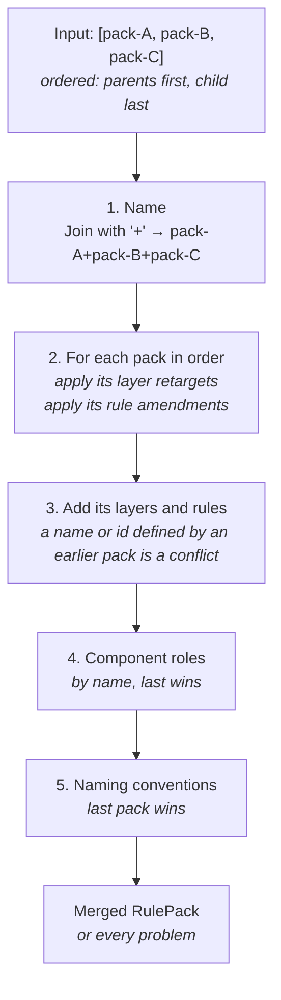
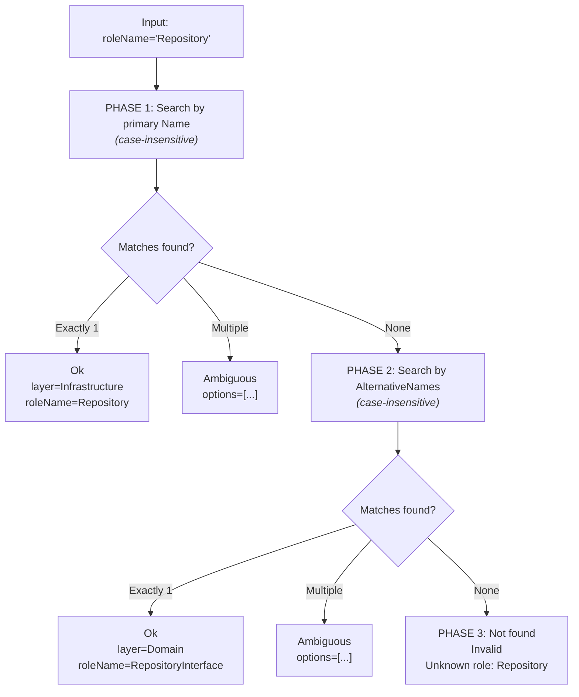

# Rule Engine

The rule engine provides two core services: pack merging and layer inference. Checking existing code against the layers, rules and roles is done by the semantic validator; see [Validation](08-validation.md).

## RulePackMerger

**Interface:** `IRulePackMerger`
**Implementation:** `RulePackMerger`

Combines an ordered list of rule packs into one resolved pack. The list is the parents in `extends` order, then the child. A conflict is an error: the merger collects every problem and fails once.

```
IRulePackMerger
  └── Merge(IReadOnlyList<RulePack> packs) → Result<RulePack, AriadneError>
```

**Merge algorithm:**



**Merge strategies per element:**

| Element | Strategy |
|---------|----------|
| Layers | Defined once. Two packs that define the same layer name fail the merge, naming both packs. A child entry that only has `name`, `namespaces` and `assemblies` retargets the inherited layer: the selectors are replaced, and `id`, `because` and `allowedDependencies` stay as the parent defined them. |
| Rules | Defined once. Two packs that define the same rule id fail the merge. A child entry that only has `id` and `exceptions` appends its exceptions to the inherited rule. If that rule is `locked`, the merge fails. |
| Component roles | By name, case-insensitive. The last role with a name wins. |
| Naming conventions | The last pack wins. |

Layer and rule keys compare case-insensitively. Retargeting a layer that no earlier pack defined, or amending a rule that no earlier pack defined, fails the merge: "pack 'x' retargets layer 'Y', which no extended pack defines" and "pack 'x' amends rule 'Z', which no extended pack defines". The conflict messages read "packs 'a' and 'b' both define layer 'Domain'" and "packs 'a' and 'b' both define rule 'ID'", and the locked message reads "rule 'ID' from pack 'a' is locked; pack 'b' cannot add exceptions".

A child cannot loosen an inherited architecture: it cannot change an inherited layer's `allowedDependencies` or `because`, and it cannot change an inherited rule other than by adding exceptions to it.

**Reserved ids.** The checks that come from component roles report generated rule ids: `ROLE-<Name>` for the type kind of the role `<Name>`, `CODE-001` for a role that requires an interface when no type matches its `interfaceRole`, and `CODE-002` for a role that asks for `internal` accessibility. The ids `CODE-001`, `CODE-002` and any id starting with `ROLE-` are reserved. A pack that declares a rule or layer with one of them fails the load with the message `id '...' is reserved for generated rules`.

Composing templates follows the same rules. `clean-architecture+cqrs` works because `cqrs` defines roles only. `clean-architecture+microservice` fails because both define `Domain`, `Application` and `Infrastructure`.

## LayerInferenceEngine

**Interface:** `ILayerInferenceEngine`
**Implementation:** `LayerInferenceEngine`

Resolves which architectural layer a component belongs to based on its role name. Uses a three-phase search with ambiguity detection.

```
ILayerInferenceEngine
  └── Infer(RulePack resolvedPack, string roleName) → LayerInferenceResult
```

**Three-phase search algorithm:**



**LayerInferenceResult model:**

| Field | Type | Description |
|-------|------|-------------|
| `Status` | `LayerInferenceStatus` | `Ok`, `Ambiguous`, or `Invalid` |
| `Layer` | `string?` | Resolved layer name (only when `Ok`) |
| `RoleName` | `string?` | Canonical role name (only when `Ok`) |
| `AmbiguousOptions` | `IReadOnlyList<string>?` | Formatted list of matches (only when `Ambiguous`) |
| `Message` | `string?` | Error or ambiguity description |

**Why alternative names matter:**

In Clean Architecture, the `RepositoryInterface` role has `alternativeNames: [Repository]`. This means if a user asks to generate a "Repository", the engine first finds the `Repository` implementation role (Phase 1 match), but if that role doesn't exist, it falls back to `RepositoryInterface` via alternative name matching (Phase 2).

---

