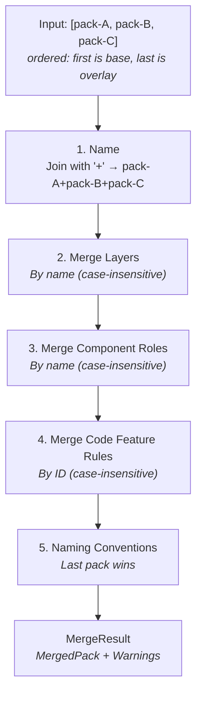
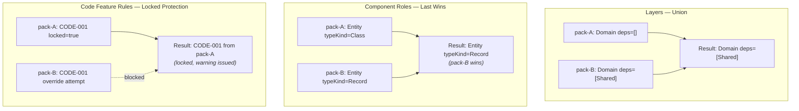
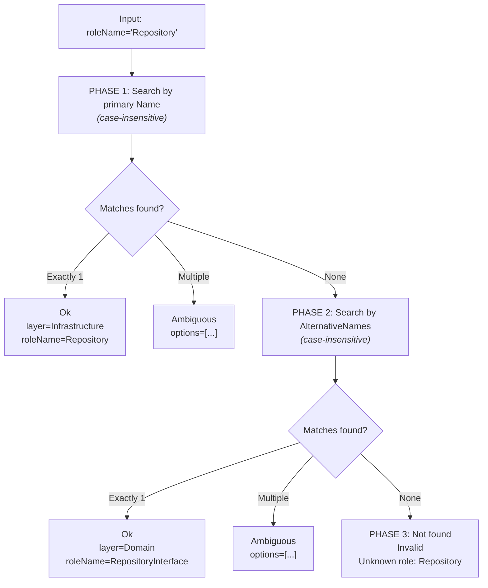

# Rule Engine

The rule engine provides two core services: pack merging and layer inference. Checking existing code against the layer rules is done by the semantic validator; see [Validation and Linting](08-validation.md).

## RulePackMerger

**Interface:** `IRulePackMerger`
**Implementation:** `RulePackMerger`

Combines multiple rule packs into a single resolved pack using deterministic merge semantics.

```
IRulePackMerger
  ├── Merge(IReadOnlyList<RulePack> packs) → RulePack
  └── MergeWithDiagnostics(IReadOnlyList<RulePack> packs) → MergeResult
```

**Merge algorithm:**



**Merge strategies per element:**



**MergeResult model:**

```
MergeResult
  ├── MergedPack: RulePack         (the combined result)
  └── Warnings: IReadOnlyList<MergeWarning>  (locked rule override attempts)
```

## LayerInferenceEngine

**Interface:** `ILayerInferenceEngine`
**Implementation:** `LayerInferenceEngine`

Resolves which architectural layer a component belongs to based on its role name. Uses a three-phase search with ambiguity detection.

```
ILayerInferenceEngine
  └── Infer(RulePack resolvedPack, string roleName) → LayerInferenceResult
```

**Three-phase search algorithm:**



**LayerInferenceResult model:**

| Field | Type | Description |
|-------|------|-------------|
| `Status` | `LayerInferenceStatus` | `Ok`, `Ambiguous`, or `Invalid` |
| `Layer` | `string?` | Resolved layer name (only when `Ok`) |
| `RoleName` | `string?` | Canonical role name (only when `Ok`) |
| `AmbiguousOptions` | `IReadOnlyList<string>?` | Formatted list of matches (only when `Ambiguous`) |
| `Message` | `string?` | Error or ambiguity description |

**Why alternative names matter:**

In Clean Architecture, the `RepositoryInterface` role has `alternativeNames: [Repository]`. This means if a user asks to generate a "Repository", the engine first finds the `Repository` implementation role (Phase 1 match), but if that role doesn't exist, it falls back to `RepositoryInterface` via alternative name matching (Phase 2).

---

