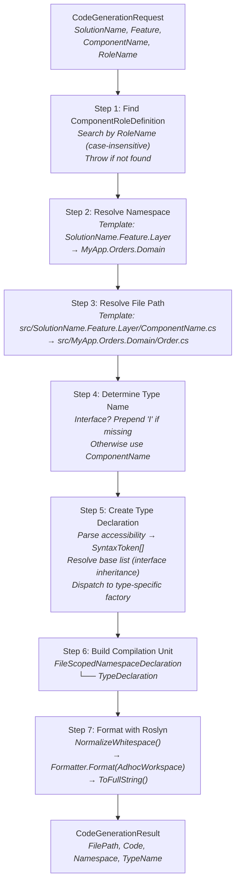

# Code Generation

The code generation pipeline transforms a `CodeGenerationRequest` into a formatted C# source file using Roslyn's `SyntaxFactory` API. No string templates or concatenation — the entire output is built from syntax nodes and formatted with the Roslyn workspace formatter.

## CodeGeneratorService

**Interface:** `ICodeGeneratorService`
**Implementation:** `CodeGeneratorService`

```
ICodeGeneratorService
  └── Generate(RulePack resolvedPack, CodeGenerationRequest request) → CodeGenerationResult
```

**Generation pipeline:**



## Accessibility Parsing

The engine maps accessibility strings to Roslyn `SyntaxToken` arrays:

| Input String | Roslyn Tokens |
|-------------|---------------|
| `"public"` | `[PublicKeyword]` |
| `"internal"` | `[InternalKeyword]` |
| `"private"` | `[PrivateKeyword]` |
| `"protected"` | `[ProtectedKeyword]` |
| `"protected internal"` | `[ProtectedKeyword, InternalKeyword]` |
| `"private protected"` | `[PrivateKeyword, ProtectedKeyword]` |
| *(anything else)* | `[PublicKeyword]` *(default)* |

## Interface Resolution

When a role has `requiresInterface: true` and an `interfaceRole`, the engine resolves the interface type name for the base list:

1. Find the `ComponentRoleDefinition` matching `interfaceRole`
2. If found and its `TypeKind` is `Interface`: check whether the type name starts with `I`
3. If not prefixed with `I`, prepend it (e.g., `OrderRepository` → `IOrderRepository`)
4. Create a `BaseListSyntax` with `SimpleBaseType(ParseTypeName(interfaceTypeName))`

**Generated output example:**

```csharp
namespace MyApp.Orders.Infrastructure;

internal class OrderRepository : IOrderRepository
{
}
```

## Type-Specific Generation

Each `CSharpTypeKind` produces different Roslyn syntax:

**Class:**
```csharp
// SyntaxFactory.ClassDeclaration("Order").AddModifiers(PublicKeyword)
public class Order
{
}
```

**Interface:**
```csharp
// SyntaxFactory.InterfaceDeclaration("IOrderRepository").AddModifiers(PublicKeyword)
public interface IOrderRepository
{
}
```

**Record:**
```csharp
// SyntaxFactory.RecordDeclaration(RecordKeyword, "OrderCreated").WithSemicolonToken()
public record OrderCreated;
```

**Struct:**
```csharp
// SyntaxFactory.StructDeclaration("Money").AddModifiers(PublicKeyword)
public struct Money
{
}
```

**Record Struct:**
```csharp
// SyntaxFactory.RecordDeclaration(RecordKeyword, "Coordinate").WithClassOrStructKeyword(StructKeyword).WithSemicolonToken()
public record struct Coordinate;
```

---

