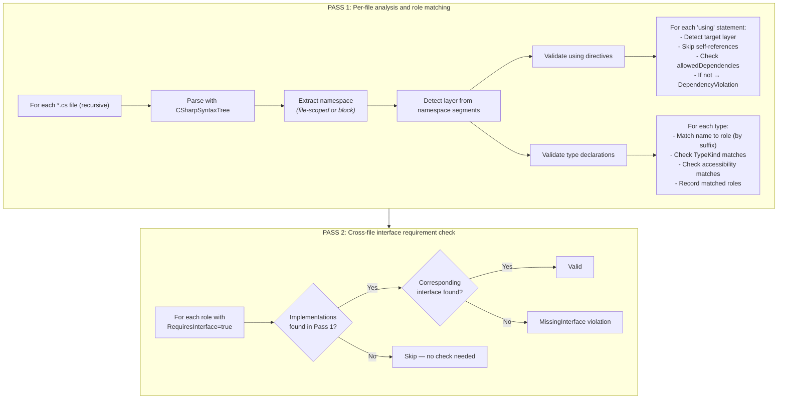
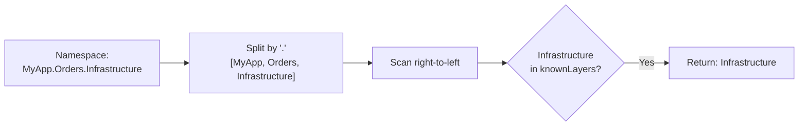
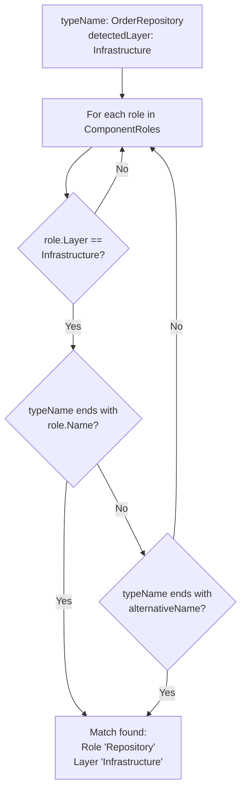
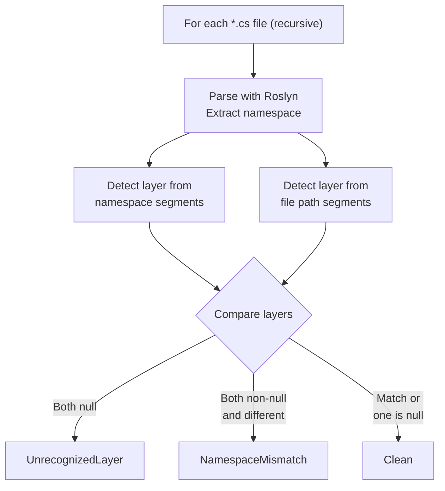

# Validation and Linting

The engine provides two levels of source code analysis: full validation (deep) and linting (shallow). Both use Roslyn to parse C# source files — no regex-based analysis.

## SourceValidator — Deep Validation

**Interface:** `ISourceValidator`
**Implementation:** `SourceValidator`

Performs comprehensive validation of existing source code against architecture rules.

```
ISourceValidator
  └── Validate(RulePack resolvedPack, string sourceDirectory) → SourceValidationResult
```

**Two-pass algorithm:**



**Layer detection algorithm (DetectLayer):**



**Type-to-role matching algorithm (MatchTypeToRole):**



**Violation types:**

| Type | Meaning | Example |
|------|---------|---------|
| `DependencyViolation` | `using` directive violates layer dependencies | Domain file using Infrastructure namespace |
| `TypeKindMismatch` | Type declaration doesn't match role's expected kind | Role says `Interface` but file has `class` |
| `AccessibilityMismatch` | Access modifier doesn't match role definition | Role says `internal` but type is `public` |
| `MissingInterface` | Role requires interface but none found in codebase | `Repository` exists but `IRepository` doesn't |

**Result model:**

```
SourceValidationResult
  ├── IsValid: bool                     (true if no violations)
  ├── Violations: IReadOnlyList<SourceViolation>
  │     ├── FilePath: string
  │     ├── ViolationType: string
  │     └── Message: string
  └── FilesScanned: int
```

## Linter — Shallow Validation

**Interface:** `ILinter`
**Implementation:** `Linter`

Performs a lighter check focused on namespace-vs-directory consistency. Does not check dependencies, type kinds, or interface requirements.

```
ILinter
  └── Lint(RulePack resolvedPack, string sourceDirectory) → LintResult
```

**Algorithm:**



**Example violation:**

```
File:       src/MyApp.Orders.Domain/OrderRepository.cs
Namespace:  MyApp.Orders.Infrastructure   ← layer = Infrastructure
Directory:  src/MyApp.Orders.Domain/       ← layer = Domain

→ NamespaceMismatch: "Namespace implies layer 'Infrastructure' but directory implies 'Domain'"
```

**Result model:**

```
LintResult
  ├── IsClean: bool
  ├── Violations: IReadOnlyList<LintViolation>
  │     ├── FilePath: string
  │     ├── Category: string
  │     └── Message: string
  └── FilesScanned: int
```

---

