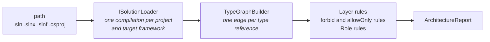

# Validation

The engine checks existing code with the compiler's semantic model on a loaded solution. There is one engine: the layer, rule and role checks all run on the same type graph.

## Semantic Validation

**Interfaces:** `ISolutionValidator` (`Ariadne.NET.Workspaces`) and `IArchitectureValidator` (`Ariadne.NET`)
**Implementations:** `SolutionValidator` and `ArchitectureValidator`

`ISolutionValidator` is the entry point for hosts that check one resolved pack. The CLI `validate` command, the stop hook and the MCP `validate_source` tool (without a `template`) call `IPackSetValidator` instead, which checks every `.yaml` or `.yml` directly in the `.architecture` folder (not `imports.yaml` or `imports.yml`, the `ariadne sync` manifest), found from the solution's folder upward. It loads the solution once, checks each pack on its own and merges the violations into one report. Each violation names its pack, and a pack that fails to load fails the check, and the message names the file once: the loader's own message when it already does, otherwise a leading `In pack file '<name>': `. A pack meant to be imported must be a `builtin://` or `import://` reference, not a file in that folder. `Ariadne.NET.Testing` runs the same check from a unit test; see [Testing](13-testing.md). The report can be written as JSON or SARIF; see [Reports](14-reports.md).

```
ISolutionValidator
  └── ValidateAsync(RulePack resolvedPack, string path, CancellationToken)
        → Task<Result<ArchitectureReport, AriadneError>>
```

It loads `path` with `ISolutionLoader`, passes the compilations to `IArchitectureValidator`, and disposes the workspace. The engine itself has no MSBuild dependency. A host that builds its own `Compilation` objects calls `IArchitectureValidator.Validate(pack, projects)` or `Validate(pack, compilation)` directly.



### The type graph

For each compilation, the engine walks every syntax tree that is not generated code and binds each type name. Every type reference that somebody wrote becomes an edge from the innermost type around it to the type it names.

What counts as a dependency:

- Base types, interfaces, attributes, member signatures, generic arguments and types used in method bodies, including `typeof`, casts, patterns and `catch` clauses.
- `var` gives nothing, because nobody wrote the type.
- An unused `using` gives nothing. A `using` directive is not a dependency; a use of what it imports is.
- An alias use gives the edges its target would give if it were written out.
- `using static` members count, and `Store.Count` counts once, as a reference to `Store`.

An edge from a type to itself is dropped. So are type parameters, `dynamic` and types the compiler cannot resolve. A member, a constructed generic type, an array and a pointer all count as the type they belong to.

### Generated code

Generated code is any of these:

- output of a source generator;
- a file that starts with an `<auto-generated>` or `<autogenerated>` header;
- a file name ending in `.g.cs`, `.g.i.cs`, `.designer.cs` or `.generated.cs`, or starting with `TemporaryGeneratedFile_`;
- `generated_code = true` in the analyzer config;
- a type marked `[GeneratedCode]`, and the types nested in it.

Generated code is never a source: it produces no edges and its types are not checked against roles. It can be a target. This is why the SDK's `GlobalUsings.g.cs` no longer counts.

### Layer of a type

A type's layer comes from the selectors of the pack's layers: a type belongs to a layer when it matches each non-empty list the layer has. Within a list any value may match, so a layer with both `namespaces` and `assemblies` covers a type only when its namespace matches one of the globs and its assembly name matches one of the patterns. Matching is ordinal and case-sensitive. This applies to source types and to types from referenced assemblies. A type that no layer covers has no layer, and a type that two layers cover is reported as a `LayerOverlap` and is left out of the dependency check. See [Rule Schema](03-rule-schema.md#selectors) for the glob grammar.

### Rules

**Layer rule.** An edge between two layers is a violation when the target layer is not in the source layer's `allowedDependencies`. The check is open-world: an edge to a type that no layer covers is not checked. All edges from one source type to one target type make one violation, located at the first reference, with a count of the references. It carries the source layer's `id` and `because`.

**Layer overlap.** A type that two or more layers cover is reported once, as `LayerOverlap`, with the covering layers named in the message. Source types are located at their declaration. A metadata type is reported once, without a location, when it is the target of a checked edge. Once means once per run: a source type that other analysed projects reference is reported only at its declaration, and a metadata type that several projects reference is reported a single time. It fails `validate` like any other violation.

**Forbid rules.** A `forbid` rule is violated by an edge from a type in `from` to a type in `to`, unless an exception matches the source type. The `from` and `to` targets are layers, or selectors over namespaces, assemblies and types. The rule applies whether or not the two types are in the same layer. One violation per rule, source type and target type, located at the first reference, with a count. Kind `ForbiddenDependency`.

**Allow-only rules.** An `allowOnly` rule is violated by an edge to a type in `to` from a source that is neither in `from` nor in `to` itself, unless an exception matches the source type. Kind `DependencyNotPermitted`, aggregated as for `forbid`.

Both kinds carry the rule's `id` and `because`. A rule whose `from` matches no type is reported as vacuous; see [Vacuous rules, roles and layers](#vacuous-rules-roles-and-layers).

**Require rules.** A `require` rule selects types with its `for` selector and checks each selected type against the requirement. A source type, nested types included, is checked once per failed requirement, unless an exception matches it. The kinds are:

| Kind | Meaning | Example |
|------|---------|---------|
| `WrongLayer` | The type is not in the layer the rule requires | Repositories must be in `Infrastructure` but one is in `Domain` |
| `TypeKindMismatch` | The type is not of the required kind | The rule says `class` but the type is a `record` |
| `AccessibilityMismatch` | The rule asks for `internal` and the type is not | The rule says `internal` but the type is `public` |
| `MissingInterface` | The type implements no interface that the `implements` selector matches, including interfaces it gets through a base class | A repository that implements no `I*Repository` |
| `RequirementNotMet` | The type fails a key of `is`, or matches a key of `isNot`; one violation per key | A domain class that is not `sealed` |

The violation carries the rule's `id` and `because`. A `require` rule whose `for` matches no type is reported as vacuous.

**Role rules.** A source type in a role's layer whose name ends with the role name or one of its `alternativeNames` matches the role. Nested types are included. Enums and delegates are never matched to a role. Each match is checked for:

| Kind | Meaning | Example |
|------|---------|---------|
| `TypeKindMismatch` | The type is not of the kind the role requires | Role says `Interface` but the type is a `class` |
| `AccessibilityMismatch` | The role asks for `internal` and the type is not | Role says `internal` but the type is `public` |
| `MissingInterface` | The role requires an interface role and no type in the checked projects matches it | `Repository` exists but no type matches `RepositoryInterface` |

The type kind is read from the symbol, so `record` and `record struct` are told apart. Accessibility is the declared accessibility, and a top-level type with no access modifier counts as internal. A nested one is private.

Role violations carry generated rule ids and a `because`. `ROLE-<Name>` is the type kind check of the role `<Name>`, and its `because` is the role's description, or `Role '<Name>' defines this shape.` when there is none. `CODE-002` is the accessibility check and `CODE-001` the missing-interface check. Their `because` text is fixed by the engine. The ids `CODE-001`, `CODE-002` and anything starting with `ROLE-` are reserved, and a pack that declares one fails to load.

### Vacuous rules, roles and layers

An element that selects no type in the projects loaded cannot fail, so it is a violation itself. A rule or a component role is reported as `VacuousRule`, and a layer as `VacuousLayer`. Both are solution-level, with no file or line, and the message names the number of projects loaded.

- The check covers the subject side only: `from` of `forbid` and `allowOnly`, `for` of `require` and `uniqueNames`, and the `matching` patterns of `slices`. `to`, `against` and `members` are not checked unless the rule sets `requireTarget: true` on a `forbid`, `allowOnly` or `uniqueNames` rule, which checks only that target selector; exceptions are never checked. See [a target that matches nothing](rule-types.md#a-target-that-matches-nothing).
- A `bannedPackages` rule is vacuous only when its `from.assemblies` is non-empty and matches no loaded project.
- A role is vacuous when no type in its layer matches it.
- A rule or role whose subject resolves only through layers already reported as vacuous gets no second violation.
- `allowEmpty: true` on a rule or a role accepts the empty selection. A layer has no opt-out; retarget it in the pack that extends the base pack. The built-in packs set `allowEmpty` on every role.
- Vacuity is relative to the projects loaded. A run on a single `.csproj` reports as vacuous the layers whose types the loaded projects neither declare nor reference; a layer in another project counts as covered when a loaded project references its types. A layer of only generated types is vacuous.

See [Rule Types](rule-types.md#rules-that-select-nothing).

### The report

```
ArchitectureReport
  ├── IsValid: bool                          (true when there are no violations)
  ├── Violations: IReadOnlyList<ArchitectureViolation>
  │     ├── RuleId: string                   (a layer id, a rule id, ROLE-<Name>, CODE-001 or CODE-002; for a vacuous role, the bare role name)
  │     ├── Kind: ViolationKind              (DependencyNotAllowed, ForbiddenDependency,
  │     │                                     DependencyNotPermitted, LayerOverlap, TypeKindMismatch,
  │     │                                     AccessibilityMismatch, MissingInterface, WrongLayer,
  │     │                                     RequirementNotMet,
  │     │                                     BannedPackage, NameCollision, SliceCycle, SliceDependency,
  │     │                                     VacuousRule, VacuousLayer)
  │     ├── SourceType: string               (fully qualified name; for a vacuous violation the layer name, rule id or role name)
  │     ├── Target: string?                  (the type depended on, absent for role, require and overlap checks)
  │     ├── Location: SourceLocation?        (file path, line, column; the first reference)
  │     ├── ReferenceCount: int
  │     ├── TargetFrameworks: IReadOnlyList<string>
  │     ├── Because: string                  (the because of the layer, rule or role; LayerOverlap has a fixed text)
  │     └── Message: string
  ├── Projects: IReadOnlyList<CheckedProject>   (name and target frameworks)
  ├── SkippedProjects: IReadOnlyList<SkippedProject>  (name and reason)
  └── TypesChecked: int
```

A missing interface has no location, because no single reference caused it. A `LayerOverlap` on a metadata type has none either. `TargetFrameworks` is empty when the violation occurs in every target framework of the project, and otherwise lists the ones it occurs in. A slices violation spans projects, so its `TargetFrameworks` name the builds whose framework scope found it, and are empty when every scope did. These can be the frameworks of a project that compiles against the source type's project, rather than the source project's own.

The CLI prints a report like this:

```
Checked 2 types in 2 projects
Result: FAIL - 1 violation(s) found.

  [DependencyNotAllowed] Shop.Domain/Order.cs:7 pack shop
    Layer 'Domain' is not allowed to depend on 'Infrastructure': Shop.Domain.Order references Shop.Infrastructure.SqlStore 3 times
    Rule SHOP-LAYER-DOMAIN: The domain holds business rules only.
```

Paths in the report are absolute. The CLI shows them relative to the directory of the solution or project it loaded, and puts a non-empty `TargetFrameworks` list in parentheses after the location, as in `Shop.Domain/Order.cs:7 (net10.0)`. After the location comes the pack the violation came from, and under the message the rule id with its `because`, when the rule has one.

### Which projects are checked

The projects the path names are checked, test projects included: all projects of a `.sln` or `.slnx`, the listed projects of a `.slnf`, and the one project of a `.csproj`. A directory works when it holds exactly one of those files. A project that the load pulls in because a named project references it is compiled as a reference only.

Projects that are not C#, or that have no language (`.dcproj`, `.shproj`, `.fsproj`, `.vbproj`), are skipped. They appear in `SkippedProjects` and the CLI prints a `Skipped` line for each.

A project that targets several frameworks is checked once per target framework. Violations with the same rule, kind, source and target merge into one, which keeps the earliest location and the highest reference count.

### Load failures

A load is complete or it is an error. It fails on compile errors (the first 5 are listed), on a `System.Object` that does not resolve, on a hand-written source file that a project lists and that is missing on disk, and on a project that is not in the workspace. MSBuildWorkspace reports MSBuild warnings as failures too, so a workspace failure fails the load only when it names no project, names a project the workspace does not hold, names a project left without references or documents, or names a project that does not compile. In the last case the error is the compile error, with the workspace failures after it; in the others it is the workspace failures. A project with workspace failures that compiles is checked. Warnings do not fail it.

Ariadne never restores. A compilation that is complete passes even without a restore. When a project fails and no `project.assets.json` is found, the error adds `run 'dotnet restore' first`.

### Requirements for package consumers

`Ariadne.NET.Workspaces` and `Ariadne.NET.Testing` need no extra reference. Both load projects with MSBuild from an installed .NET SDK, which they find with MSBuildLocator, and the `buildTransitive` targets file of `Ariadne.NET.Workspaces` keeps `Microsoft.Build.Framework` and `Microsoft.NET.StringTools` out of the output, so the build does not fail with `MSBL001`. Up to 0.8, a project that referenced `Ariadne.NET.Workspaces` needed its own `Microsoft.Build.Framework` line; remove it when you upgrade, or restore fails with `NU1605`. The `BuildHost-*` folders that the workspace needs come with the package.

The workspace runs the source generators the design-time build lists, including those of the SDK, such as the Razor generator. A generator built against a newer Microsoft.CodeAnalysis than Ariadne runs cannot load, and the code it would generate is missing. When a project then has compile errors, the error first names each analyzer whose file is missing or unreadable, is not a .NET assembly, or is built against a newer Microsoft.CodeAnalysis, and says which. The check reads only the analyzer file's metadata, so a generator that fails later, for example on a missing dependency of its own, is not named.

### Performance

The load and check times and the allocations of the check on this repository's own solution are recorded in `docs/perf/phase-2.1-baseline.md`, with the phase 2.2 re-measurement in its own section.
