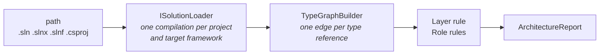
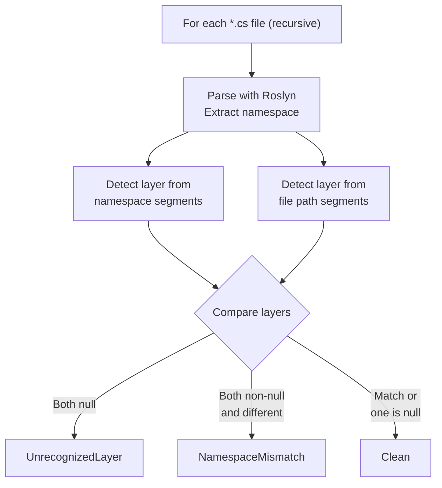

# Validation and Linting

The engine checks existing code at two levels: validation (deep) and linting (shallow). Validation uses the compiler's semantic model on a loaded solution. The linter parses files with Roslyn and compares namespaces with directories.

## Semantic Validation

**Interfaces:** `ISolutionValidator` (`Ariadne.NET.Workspaces`) and `IArchitectureValidator` (`Ariadne.NET`)
**Implementations:** `SolutionValidator` and `ArchitectureValidator`

`ISolutionValidator` is the entry point for hosts. The CLI `validate` command and the MCP `validate_source` tool both call it.

```
ISolutionValidator
  └── ValidateAsync(RulePack resolvedPack, string path, CancellationToken)
        → Task<Result<ArchitectureReport, AriadneError>>
```

It loads `path` with `ISolutionLoader`, passes the compilations to `IArchitectureValidator`, and disposes the workspace. The engine itself has no MSBuild dependency. A host that builds its own `Compilation` objects calls `IArchitectureValidator.Validate(pack, projects)` or `Validate(pack, compilation)` directly.



### The type graph

For each compilation, the engine walks every syntax tree that is not generated code and binds each type name. Every type reference that somebody wrote becomes an edge from the innermost type around it to the type it names.

What counts as a dependency:

- Base types, interfaces, attributes, member signatures, generic arguments and types used in method bodies, including `typeof`, casts, patterns and `catch` clauses.
- `var` gives nothing, because nobody wrote the type.
- An unused `using` gives nothing. A `using` directive is not a dependency; a use of what it imports is.
- An alias use gives the edges its target would give if it were written out.
- `using static` members count, and `Store.Count` counts once, as a reference to `Store`.

An edge from a type to itself is dropped. So are type parameters, `dynamic` and types the compiler cannot resolve. A member, a constructed generic type, an array and a pointer all count as the type they belong to.

### Generated code

Generated code is recognised as Roslyn's analyzers recognise it:

- output of a source generator;
- a file that starts with an `<auto-generated>` or `<autogenerated>` header;
- a file name ending in `.g.cs`, `.g.i.cs`, `.designer.cs` or `.generated.cs`, or starting with `TemporaryGeneratedFile_`;
- `generated_code = true` in the analyzer config;
- a type marked `[GeneratedCode]`, and the types nested in it.

Generated code is never a source: it produces no edges and its types are not checked against roles. It can be a target. This is why the SDK's `GlobalUsings.g.cs` no longer counts.

### Layer of a type

A type's layer is the last segment of its namespace that equals a layer name, ignoring case. This applies to source types and to types from referenced assemblies. A type with no such segment has no layer, and it is not constrained as a source or as a target.

### Rules

**Layer rule.** An edge between two layers is a violation when the target layer is not in the source layer's `allowedDependencies`. All edges from one source type to one target type make one violation, located at the first reference, with a count of the references.

**Role rules.** A source type in a role's layer whose name ends with the role name or one of its `alternativeNames` matches the role. Nested types are included. Each match is checked for:

| Kind | Meaning | Example |
|------|---------|---------|
| `TypeKindMismatch` | The type is not of the kind the role requires | Role says `Interface` but the type is a `class` |
| `AccessibilityMismatch` | The role asks for `internal` and the type is not | Role says `internal` but the type is `public` |
| `MissingInterface` | The role requires an interface role and no type in the checked projects matches it | `Repository` exists but no type matches `RepositoryInterface` |

The type kind is read from the symbol, so `record` and `record struct` are told apart. Accessibility is the declared accessibility, and a type with no access modifier counts as internal.

Two verdicts differ from the old validator, which looked at `using` directives and keywords in the file text. A type with no access modifier now passes an `internal` role, where it used to be reported as public. An unused `using` is no longer a dependency.

### The report

```
ArchitectureReport
  ├── IsValid: bool                          (true when there are no violations)
  ├── Violations: IReadOnlyList<ArchitectureViolation>
  │     ├── RuleId: string                   (layer/<Layer> or role/<Role>)
  │     ├── Kind: ViolationKind              (DependencyNotAllowed, TypeKindMismatch,
  │     │                                     AccessibilityMismatch, MissingInterface)
  │     ├── SourceType: string               (fully qualified name)
  │     ├── Target: string?                  (the type depended on, absent for role checks)
  │     ├── Location: SourceLocation?        (file path, line, column; the first reference)
  │     ├── ReferenceCount: int
  │     ├── TargetFrameworks: IReadOnlyList<string>
  │     ├── Because: string                  (empty for built-in rule packs)
  │     └── Message: string
  ├── Projects: IReadOnlyList<CheckedProject>   (name and target frameworks)
  ├── SkippedProjects: IReadOnlyList<SkippedProject>  (name and reason)
  └── TypesChecked: int
```

A missing interface has no location, because no single reference caused it. `TargetFrameworks` is empty when the violation occurs in every target framework of the project, and otherwise lists the ones it occurs in.

The CLI prints a report like this:

```
Checked 2 types in 2 projects
Result: FAIL - 1 violation(s) found.

  [DependencyNotAllowed] Shop.Domain/Order.cs:7
    Layer 'Domain' is not allowed to depend on 'Infrastructure': Shop.Domain.Order references Shop.Infrastructure.SqlStore 3 times
```

Paths in the report are absolute. The CLI shows them relative to the directory of the solution or project it loaded.

### Which projects are checked

The projects the path names are checked, test projects included: all projects of a `.sln` or `.slnx`, the listed projects of a `.slnf`, and the one project of a `.csproj`. A directory works when it holds exactly one of those files. A project that the load pulls in because a named project references it is compiled as a reference only.

Projects that are not C#, or that have no language (`.dcproj`, `.shproj`, `.fsproj`, `.vbproj`), are skipped. They appear in `SkippedProjects` and the CLI prints a `Skipped` line for each.

A project that targets several frameworks is checked once per target framework. Violations with the same rule, kind, source and target merge into one, which keeps the earliest location and the highest reference count.

### Load failures

A load is complete or it is an error. It fails on a workspace failure, on compile errors (the first 5 are listed), on a `System.Object` that does not resolve, and on a hand-written source file that a project lists and that is missing on disk. Warnings do not fail it.

Ariadne never restores. A compilation that is complete passes even without a restore. When a project fails and no `project.assets.json` is found, the error adds `run 'dotnet restore' first`.

### Requirements for package consumers

`Ariadne.NET.Workspaces` loads projects with MSBuild from an installed .NET SDK, which it finds with MSBuildLocator. A project that references the package must also add its own reference, or the build fails with `MSBL001`:

```xml
<PackageReference Include="Microsoft.Build.Framework" Version="17.11.48" ExcludeAssets="runtime" />
```

The `BuildHost-*` folders that the workspace needs come with the package.

### Performance

The load and check times and the allocations of the check on this repository's own solution are recorded in `docs/perf/phase-2.1-baseline.md`.

## Linter — Shallow Validation

**Interface:** `ILinter`
**Implementation:** `Linter`

Performs a lighter check focused on namespace-vs-directory consistency. Does not check dependencies, type kinds, or interface requirements.

```
ILinter
  └── Lint(RulePack resolvedPack, string sourceDirectory) → LintResult
```

**Algorithm:**



**Example violation:**

```
File:       src/MyApp.Orders.Domain/OrderRepository.cs
Namespace:  MyApp.Orders.Infrastructure   ← layer = Infrastructure
Directory:  src/MyApp.Orders.Domain/       ← layer = Domain

→ NamespaceMismatch: "Namespace implies layer 'Infrastructure' but directory implies 'Domain'"
```

**Result model:**

```
LintResult
  ├── IsClean: bool
  ├── Violations: IReadOnlyList<LintViolation>
  │     ├── FilePath: string
  │     ├── Category: string
  │     └── Message: string
  └── FilesScanned: int
```

---

