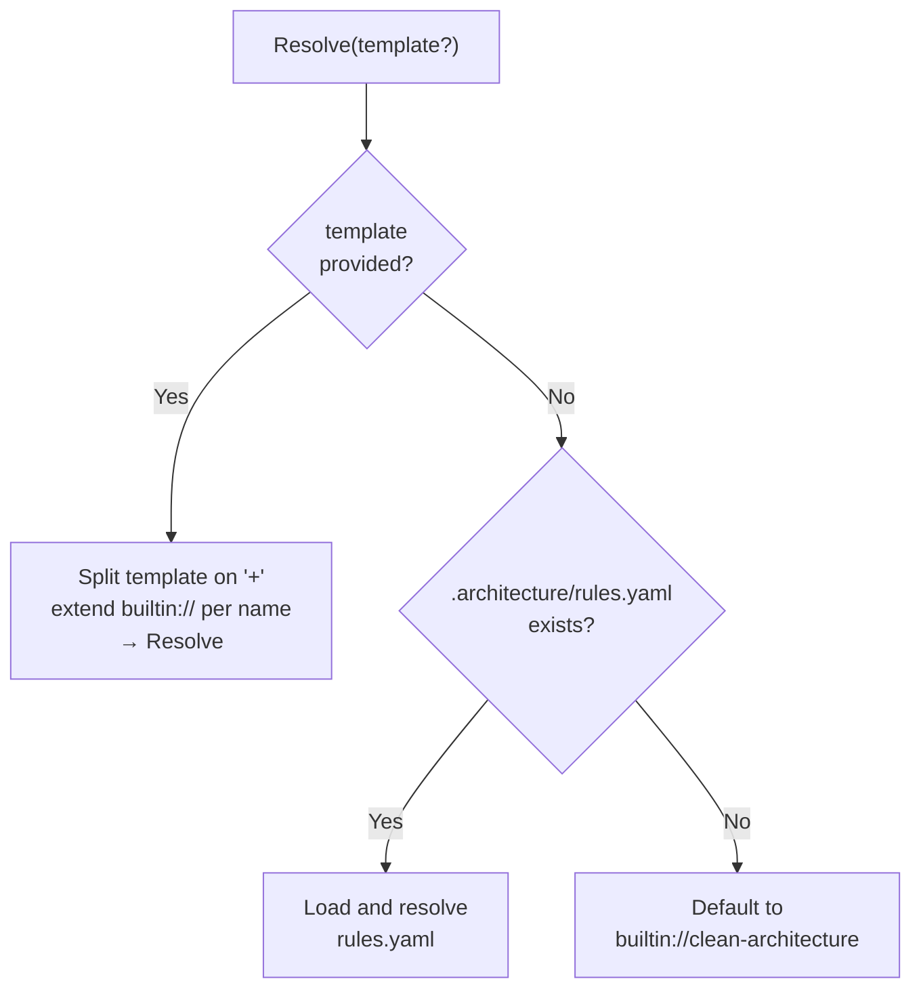

# Host Applications

The engine ships with three host applications, each targeting a different use case. All share the same core engine via `services.AddAriadneNETServices()`.

## CLI (Ariadne.NET.Cli)

Built with **System.CommandLine 3.0** (uses `Command`, `RootCommand`, `Option<T>` — no `Cli` prefix).

**Commands:**

### `init` — Initialize architecture rules

> Until the `ariadne` dotnet tool ships, run these commands as `dotnet run --project src/Ariadne.NET.Cli -- <command>`.

```bash
ariadne init --template clean-architecture
ariadne init --template clean-architecture+cqrs+ddd-tactical
```

- Splits template string by `+`
- Validates each pack name exists in the registry
- Creates `.architecture/rules.yaml` with `schema: 2`, a `name` taken from the current directory and the `extends` list

`ariadne init --agent claude` also installs the hooks. It merges the three entries shown under "Install the hooks without `init`" into `.claude/settings.json` and keeps every other setting, replaces the entries it wrote on an earlier run instead of duplicating them, and keeps an existing `.architecture/rules.yaml`. It fails without writing anything when the settings file is not valid JSON or has an unexpected shape. The first run may reformat an existing settings file, because it is written back as indented JSON. It prints `Added the Ariadne hooks to .claude/settings.json`, or `The Ariadne hooks are already in .claude/settings.json` when the file needed no change. The only accepted agent is `claude`.

### `rules` — Print resolved layer rules

```bash
ariadne rules
```

- Loads `.architecture/rules.yaml` from current directory
- Resolves all extends references
- Prints each layer with its id, its selectors and the layers it depends on, then each rule with its id, targets, number of exceptions and `because`, then the number of component roles and the naming conventions

### `roles` — Print component roles table

```bash
ariadne roles
```

- Resolves rules, then prints a formatted table:
  `Name | Layer | TypeKind | RequiresInterface | Description`

### `generate` — Generate a component

```bash
ariadne generate --role Entity --name Order --solution MyApp --feature Orders
```

| Option | Short | Type | Description |
|--------|-------|------|-------------|
| `--role` | `-r` | `string` | Component role (e.g., `Entity`, `Repository`) |
| `--name` | `-n` | `string` | Component name (e.g., `Order`) |
| `--solution` | `-s` | `string` | Solution name |
| `--feature` | `-f` | `string` | Feature name |

Prints the generated file path, namespace, type name, and full source code.

### `validate` — Validate a solution or project

```bash
ariadne validate
ariadne validate MyApp.slnx
ariadne validate /path/to/MyApp.csproj
```

- Argument: `path` (default: `"."`), a `.sln`, `.slnx`, `.slnf` or `.csproj` file, or a directory that holds exactly one of them
- `--format text|json|sarif` (default `text`) and `--output <file>`: write a JSON or SARIF report, or put the report in a file. With `json` or `sarif` and no `--output`, the report is alone on standard output and the text report goes to standard error. See [Reports](14-reports.md)
- Finds the pack set: every `.yaml` or `.yml` directly in the `.architecture` folder (not `imports.yaml` or `imports.yml`, the `ariadne sync` manifest), looked up from the solution's folder upward, not the working directory's `rules.yaml`. Each pack is loaded, resolved and checked on its own, and an error that does not already name the file is prefixed with `In pack file '<name>': `. A pack meant to be imported must be a `builtin://` or `import://` reference, because every file in the folder is checked as a pack
- Loads the projects once with `IPackSetValidator` and checks each one against every pack; Ariadne never restores, so run `dotnet restore` first
- Prints the number of types and projects checked, a `Skipped` line for each skipped project, and each violation as `[Kind] file:line pack <name>` followed by its message and, when the rule has a `because`, a `Rule <id>: <because>` line; a violation found in only some target frameworks lists them after the location, as in `[Kind] file:line (net10.0)`
- Exit codes: 0 no violations, 1 violations, 2 error, which includes a report that cannot be written. A cancelled run prints `Cancelled.`. An unknown `--format` is a usage error and currently exits 1

```
Checked 2 types in 2 projects
Result: FAIL - 1 violation(s) found.

  [DependencyNotAllowed] Shop.Domain/Order.cs:7 pack shop
    Layer 'Domain' is not allowed to depend on 'Infrastructure': Shop.Domain.Order references Shop.Infrastructure.SqlStore 3 times
    Rule SHOP-LAYER-DOMAIN: The domain holds business rules only.
```

File paths in the text report are shown relative to the directory of the solution or project. The JSON and SARIF reports use the repository root instead.

### `sync` — Sync rule packs from git

```bash
ariadne sync                              # sync all imports
ariadne sync --name company-standards     # sync one import
ariadne sync --no-cache                   # force fresh fetch
```

| Option | Short | Type | Description |
|--------|-------|------|-------------|
| `--no-cache` | — | `bool` | Force fresh sync, ignore cache |
| `--name` | `-n` | `string?` | Sync only this import |

- Loads `.architecture/imports.yaml`
- Cache directory: `.architecture/.cache/git/`
- Prints import name, resolved version, and cached/fetched status

### `hook` — Run an agent hook

```bash
ariadne hook session-start
ariadne hook pre-tool-use
ariadne hook stop
```

`ariadne hook <event>` is the entry point Claude Code runs for its hooks. It reads the hook input as JSON on stdin and prints a JSON answer on stdout, both UTF-8 without a byte order mark. The root it works in is the nearest folder from the `cwd` of the input upwards that has `.architecture/rules.yaml`, so it keeps working after the agent has run `cd` into a subfolder. When no folder has one, it uses the folder the `CLAUDE_PROJECT_DIR` environment variable names, if that is set and exists, and otherwise the `cwd` itself.

| Event | What it does |
|-------|--------------|
| `session-start` | Adds the resolved layers, the rules with their `because`, the component roles, the naming conventions and the versions of the cached rule packs to the session. It warns when an import is missing from the cache or no longer satisfies its version range. The text is capped at 10,000 characters; when it does not fit, whole roles, rules and layers are dropped from the end, then the naming line, then the warnings, and a final `Truncated` line says how many lines went. Without a rules file it tells the agent to run `ariadne init`. |
| `pre-tool-use` | Answers only `ask`, and only for a new `.cs` file whose assembly and namespace no layer selects. The namespace is read from the content that is written, with the folder as the fallback. It also records every `.cs` file that `Write`, `Edit` and `MultiEdit` touch, for `stop`. |
| `stop` | Once per turn, when the agent edited `.cs` files, validates the solution found from the working directory against every pack in the `.architecture` folder above it, and feeds at most 20 violations back through `additionalContext`, each with its message and, when it has one, its rule id and `because` and the `Pack:` line naming the pack that raised it. The text is capped at 10,000 characters too, and a final line says how many violations were left out. It prints nothing when the solution is clean, when `stop_hook_active` is set, and when no `.cs` file was edited. |

The stale-cache check is offline. It compares the version ranges in `.architecture/imports.yaml` with `resolvedTag` in `.architecture/.cache/git/<name>/.git-info.json` and never touches the network. Run `ariadne sync` to refresh the cache.

The hooks fail open. Every error becomes one line on stderr, stdout stays empty and the exit code is 0, because in Claude Code exit code 2 blocks a tool call and any other non-zero code is reported as an error. The only exception is a missing event argument, which is a usage error with exit code 1.

Limits to know about:

- A project that no layer selects, such as tests, samples and tools, makes the new-file check ask on every new file there.
- `stop` loads the whole solution, so it takes seconds; see `docs/perf/phase-5.6-hooks.md` for numbers.
- The `ariadne` command must be on `PATH`. It is not a dotnet tool until phase 3.3. To try a hook from a checkout, run `dotnet run --project src/Ariadne.NET.Cli -- hook session-start`, or run the built dll with `dotnet <path to Ariadne.NET.Cli.dll> hook session-start`.

Ariadne's hooks run beside AI.Sentinel's hook. Ariadne owns the structure rules and getting them to the agent; AI.Sentinel owns tool-call enforcement. Claude Code runs the matching hooks in parallel and resolves `PreToolUse` decisions as deny, then defer, then ask, then allow, so Ariadne's `ask` never overrides a deny from AI.Sentinel.

#### Install the hooks without `init`

`ariadne init --agent claude` writes these entries for you. A project that does not use `init` adds them to `.claude/settings.json` by hand:

```json
{
  "hooks": {
    "SessionStart": [
      { "hooks": [ { "type": "command", "command": "ariadne hook session-start", "timeout": 30 } ] }
    ],
    "PreToolUse": [
      {
        "matcher": "Write|Edit|MultiEdit",
        "hooks": [ { "type": "command", "command": "ariadne hook pre-tool-use", "timeout": 10 } ]
      }
    ],
    "Stop": [
      { "hooks": [ { "type": "command", "command": "ariadne hook stop", "timeout": 300 } ] }
    ]
  }
}
```

### Rules file resolution

`rules`, `roles` and the other commands that need one pack use `RulesCommand.ResolveRulesFromFile()`. `validate` does not: it checks every pack in the `.architecture` folder, found from the solution's folder upward.

1. Look for `.architecture/rules.yaml` in the current directory
2. If not found, throw `FileNotFoundException` with helpful message
3. Load with `IRulePackLoader`
4. Resolve with `IRulePackResolver`
5. Return resolved `RulePack`

## MCP HTTP Host (Ariadne.NET.Mcp.Http)

A thin ASP.NET Core host that exposes the MCP server over HTTP for remote/team access. No REST controllers — all capabilities are served via the MCP protocol at `/mcp`.

```csharp
builder.Services.AddAriadneNETServices();
builder.Services.AddAriadneNETMcpServices();   // registers RuleResolutionHelper
builder.Services.AddMcpServer()
    .WithHttpTransport()
    .WithToolsFromAssembly(typeof(TemplateTools).Assembly)
    .WithResourcesFromAssembly(typeof(PackResources).Assembly);

app.MapMcp();
```

The same MCP tools and resources available via stdio are available over HTTP — zero duplication between hosts.

## MCP Server (Ariadne.NET.Mcp)

Built with the **ModelContextProtocol SDK** for AI agent integration.

**Transports:**
- **Stdio** — local process communication (for Claude Code, Cursor, etc.)
- **HTTP** — remote access via the API server's `/mcp` endpoint

**RuleResolutionHelper** — shared logic for all MCP tools:



**MCP Tools:**

| Tool | Parameters | Returns | Description |
|------|-----------|---------|-------------|
| `list_templates` | — | `IReadOnlyList<string>` | List available templates |
| `get_layers` | `template?` | `IList<LayerDefinition>` | Layers with id, selectors, dependencies and because |
| `get_component_roles` | `template?` | `IList<ComponentRoleDefinition>` | Available roles for code generation |
| `get_rules` | `template?` | `IList<RuleDefinition>` | Forbid and allowOnly rules with id, targets, exceptions and because |
| `generate_component` | `role`, `name`, `solution`, `feature`, `template?` | `GenerateResult` | Generate a C# component |
| `generate_workspace` | `solution`, `features`, `template?` | `WorkspaceGenerateResult` | Scaffold project structure |
| `validate_source` | `path`, `template?` | `ArchitectureReport` | Validate a solution or project against rules |

**MCP Resources:**

| URI Template | Returns | Description |
|-------------|---------|-------------|
| `ariadne://packs/{name}` | Raw YAML string | Full content of a built-in pack |

The other tools auto-detect `.architecture/rules.yaml` in the working directory. `validate_source` without a `template` checks every `.yaml` or `.yml` directly in the `.architecture` folder (not `imports.yaml` or `imports.yml`, the `ariadne sync` manifest), found from the solution's folder upward, and, when no `.architecture` folder is found, falls back to the `rules.yaml` in the working directory's `.architecture` folder, else to `clean-architecture`; its violations name their pack. The `template` parameter overrides auto-detection and checks that one pack.

---

