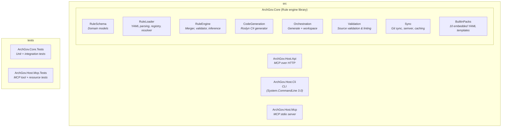
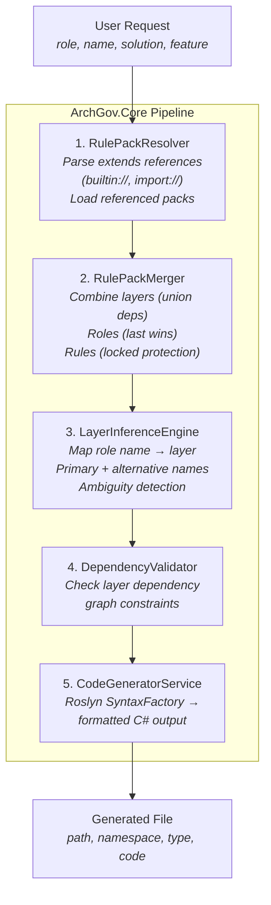
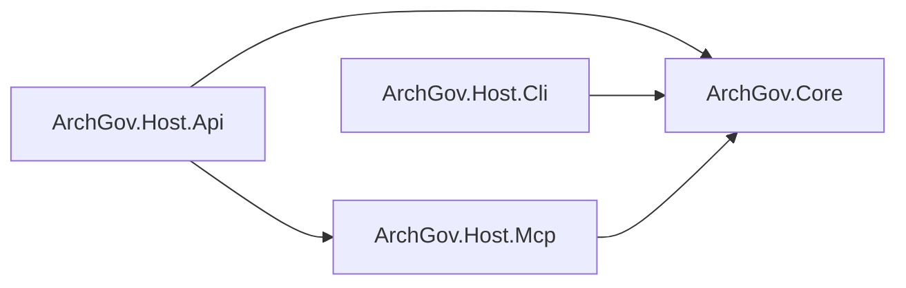
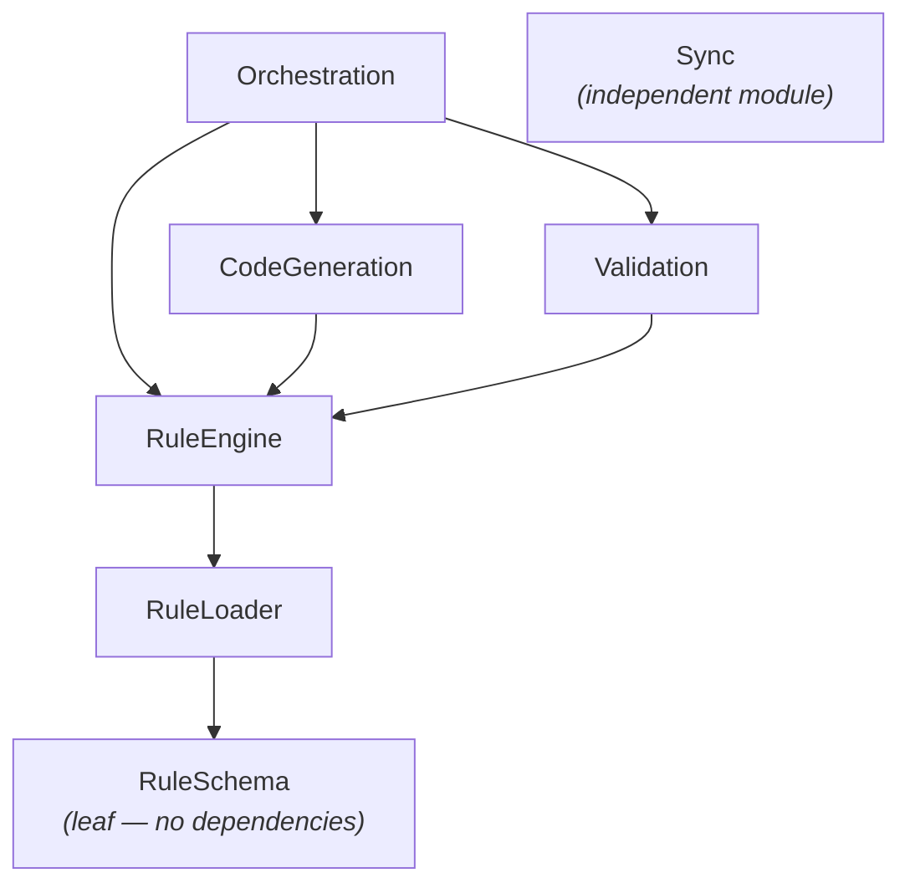

# Architecture

## Solution Structure

## Core Pipeline

The engine processes a user request through a series of stages:

## Dependency Flow

All three host applications depend on `ArchGov.Core`. The only host-to-host dependency is `ArchGov.Host.Api` → `ArchGov.Host.Mcp`, so the HTTP transport serves the same MCP tools and resources as stdio.

Within `ArchGov.Core`, dependencies flow strictly top-down:

---

Previous: [Overview](01-overview.md) | Next: [Rule Schema](03-rule-schema.md)
