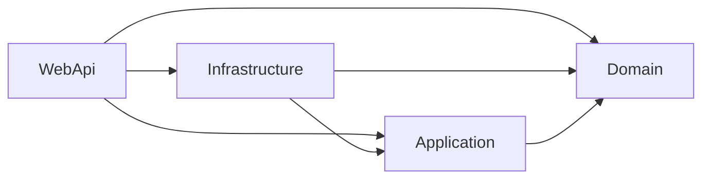

# Rule Schema

The rule schema defines the domain model for architecture governance. All models are sealed classes with `required` properties and sensible defaults, using `IList<T>` and `IDictionary<string, object>` in public APIs (per analyzer rule MA0016).

## RulePack — The Root Model

`RulePack` is the top-level container for an architecture definition. Every YAML file maps to a single `RulePack` instance.

| Property | Type | Default | Description |
|----------|------|---------|-------------|
| `Name` | `string` | *(required)* | Unique identifier for the pack (e.g., `"clean-architecture"`) |
| `Version` | `string` | `"1.0.0"` | Semantic version of the pack |
| `Author` | `string` | `""` | Pack author or maintainer |
| `Extends` | `IList<string>` | `[]` | Parent pack references (`builtin://name` or `import://name`) |
| `Layers` | `IList<LayerDefinition>` | `[]` | Architectural layers with dependency rules |
| `ComponentRoles` | `IList<ComponentRoleDefinition>` | `[]` | Component archetypes (Entity, Repository, Controller, etc.) |
| `CodeFeatureRules` | `IList<CodeFeatureRuleDefinition>` | `[]` | Structural enforcement rules |
| `NamingConventions` | `NamingConventions` | `new()` | Templates for namespaces and file paths |

**YAML example:**

```yaml
name: clean-architecture
version: "1.0.0"
author: "Architecture Team"

extends:
  - builtin://ddd-tactical

layers:
  - name: Domain
    allowedDependencies: []
  - name: Application
    allowedDependencies: [Domain]

componentRoles:
  - name: Entity
    layer: Domain
    typeKind: Class

namingConventions:
  namespace: "{SolutionName}.{Feature}.{Layer}"
  filePath: "src/{SolutionName}.{Feature}.{Layer}/{ComponentName}.cs"
```

## LayerDefinition

Defines an architectural layer and its allowed dependencies. The `allowedDependencies` list enforces a unidirectional dependency graph — a layer can only reference layers in its allow-list.

| Property | Type | Default | Description |
|----------|------|---------|-------------|
| `Name` | `string` | *(required)* | Layer identifier (e.g., `"Domain"`, `"Infrastructure"`) |
| `Description` | `string` | `""` | Human-readable explanation of the layer's responsibilities |
| `AllowedDependencies` | `IList<string>` | `[]` | Layer names this layer may depend on |

**Key constraint:** An empty `AllowedDependencies` means the layer is a leaf — it depends on nothing and sits at the center of the architecture (e.g., Domain in Clean Architecture).

**Dependency graph example (Clean Architecture):**



```yaml
layers:
  - name: Domain
    description: "Entities, value objects, domain services"
    allowedDependencies: []          # innermost — no outward dependencies
  - name: Application
    description: "Use cases, commands, queries"
    allowedDependencies: [Domain]    # can access Domain
  - name: Infrastructure
    description: "Repositories, external services"
    allowedDependencies: [Domain, Application]
  - name: WebApi
    description: "Controllers, middleware"
    allowedDependencies: [Domain, Application, Infrastructure]
```

## ComponentRoleDefinition

Defines a component archetype — a stereotype that maps a role name to a specific layer, C# type kind, accessibility, and interface requirement.

| Property | Type | Default | Description |
|----------|------|---------|-------------|
| `Name` | `string` | *(required)* | Role identifier (e.g., `"Entity"`, `"Repository"`) |
| `Layer` | `string` | *(required)* | The architectural layer this role belongs to |
| `TypeKind` | `CSharpTypeKind` | `Class` | C# type: `Class`, `Interface`, `Record`, `Struct`, `RecordStruct` |
| `RequiresInterface` | `bool` | `false` | Whether the implementation must have a corresponding interface |
| `InterfaceRole` | `string?` | `null` | Name of the paired interface role definition |
| `Accessibility` | `string` | `"public"` | Access modifier: `public`, `internal`, `private`, `protected`, `protected internal`, `private protected` |
| `Description` | `string` | `""` | Purpose and usage guidance |
| `AlternativeNames` | `IList<string>` | `[]` | Aliases for role matching (used by the layer inference engine) |

**Interface pairing pattern:**

Roles often come in pairs — an interface definition in one layer and an implementation in another. This enforces the Dependency Inversion Principle:

```yaml
# Contract in Domain layer (public interface)
- name: RepositoryInterface
  layer: Domain
  typeKind: Interface
  accessibility: public
  alternativeNames: [Repository]

# Implementation in Infrastructure layer (internal class)
- name: Repository
  layer: Infrastructure
  typeKind: Class
  requiresInterface: true
  interfaceRole: RepositoryInterface
  accessibility: internal
```

When generating a `Repository`, the engine knows:
- The class goes in `Infrastructure` (from `layer`)
- It must be `internal` (from `accessibility`)
- It must implement `IOrderRepository` (from `requiresInterface` + `interfaceRole`)

## CodeFeatureRuleDefinition

Defines a structural enforcement rule with an optional lock mechanism to prevent downstream overrides.

| Property | Type | Default | Description |
|----------|------|---------|-------------|
| `Id` | `string` | *(required)* | Unique rule identifier (e.g., `"CODE-001"`) |
| `Description` | `string` | *(required)* | What the rule enforces |
| `AppliesTo` | `IDictionary<string, object>` | `{}` | Predicate filters for rule targeting |
| `Locked` | `bool` | `false` | If `true`, cannot be overridden by downstream packs |

The `AppliesTo` dictionary uses string keys with object values, allowing flexible predicate composition:

```yaml
codeFeatureRules:
  - id: CODE-001
    description: "Interface-required roles must have a matching interface"
    appliesTo:
      requiresInterface: true
    locked: true    # downstream packs cannot change this rule

  - id: CODE-002
    description: "Implementations with required interfaces should be internal"
    appliesTo:
      requiresInterface: true
      isInterface: false
```

## NamingConventions

Template strings for namespace and file path resolution, using four substitution variables.

| Property | Type | Default | Description |
|----------|------|---------|-------------|
| `Namespace` | `string` | `"{SolutionName}.{Feature}.{Layer}"` | C# namespace template |
| `FilePath` | `string` | `"src/{SolutionName}.{Feature}.{Layer}/{ComponentName}.cs"` | Output file path template |

**Template variables:**

| Variable | Source | Example |
|----------|--------|---------|
| `{SolutionName}` | User input | `MyApp` |
| `{Feature}` | User input | `Orders` |
| `{Layer}` | Inferred from role | `Domain` |
| `{ComponentName}` | User input | `Order` |

**Resolution example:**

```
Template:  {SolutionName}.{Feature}.{Layer}
Input:     SolutionName=MyApp, Feature=Orders, Role=Entity → Layer=Domain
Result:    MyApp.Orders.Domain
```

## CSharpTypeKind

Enum mapping to C# type declarations:

| Value | C# Output | Roslyn Factory |
|-------|-----------|----------------|
| `Class` | `public class Order { }` | `SyntaxFactory.ClassDeclaration()` |
| `Interface` | `public interface IOrderRepository { }` | `SyntaxFactory.InterfaceDeclaration()` |
| `Record` | `public record OrderCreated;` | `SyntaxFactory.RecordDeclaration()` |
| `Struct` | `public struct Money { }` | `SyntaxFactory.StructDeclaration()` |
| `RecordStruct` | `public record struct Coordinate;` | `SyntaxFactory.RecordDeclaration()` with `StructKeyword` |

---

Previous: [Architecture](02-architecture.md) | Next: [Rule Loading Pipeline](04-rule-loading.md)
