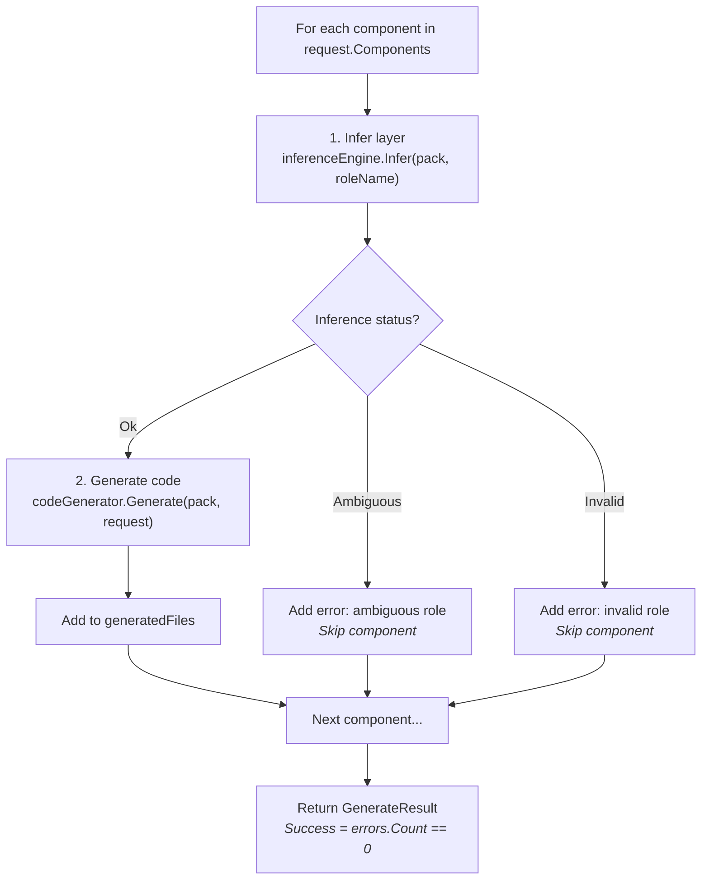
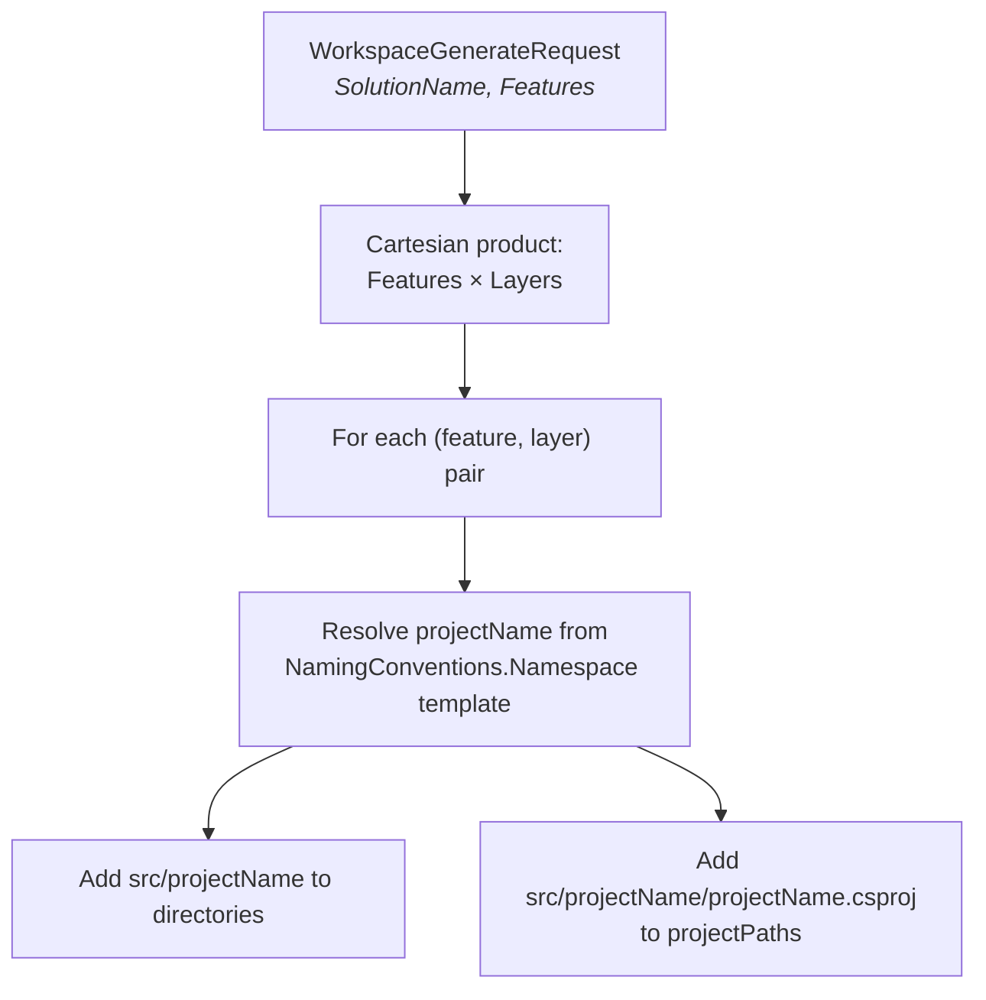
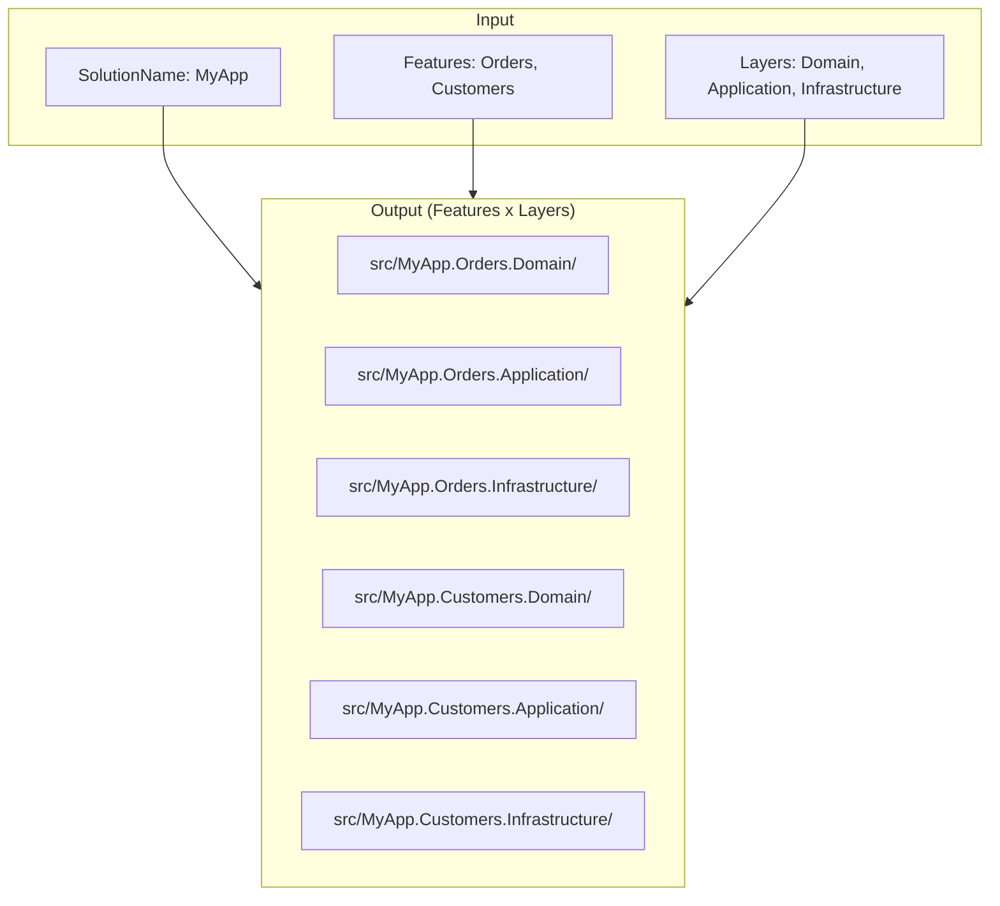

# Orchestration

Orchestrators wire together the lower-level services into high-level workflows.

## GenerateOrchestrator

**Interface:** `IGenerateOrchestrator`
**Implementation:** `GenerateOrchestrator`

Generates code for one or more components in a single request.

```
IGenerateOrchestrator
  └── Generate(RulePack resolvedPack, GenerateRequest request) → GenerateResult
```

**Request/Response models:**

```
GenerateRequest
  ├── SolutionName: string        (e.g., "MyApp")
  ├── Feature: string             (e.g., "Orders")
  └── Components: IReadOnlyList<ComponentRequest>
        ├── RoleName: string      (e.g., "Entity")
        └── Name: string          (e.g., "Order")

GenerateResult
  ├── Success: bool               (true if no errors)
  ├── GeneratedFiles: IReadOnlyList<CodeGenerationResult>
  ├── Errors: IReadOnlyList<string>
  └── DependencyViolations: IReadOnlyList<DependencyViolation>
```

**Algorithm:**



## WorkspaceOrchestrator

**Interface:** `IWorkspaceOrchestrator`
**Implementation:** `WorkspaceOrchestrator`

Generates the full project directory and `.csproj` path structure for a solution based on the Cartesian product of features and layers.

```
IWorkspaceOrchestrator
  └── GenerateWorkspace(RulePack resolvedPack, WorkspaceGenerateRequest request) → WorkspaceGenerateResult
```

**Algorithm:**



**Example:**



---

Previous: [Code Generation](06-code-generation.md) | Next: [Validation and Linting](08-validation.md)
