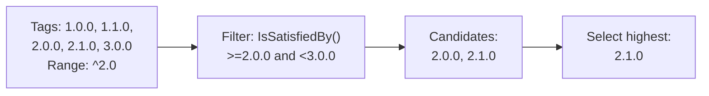
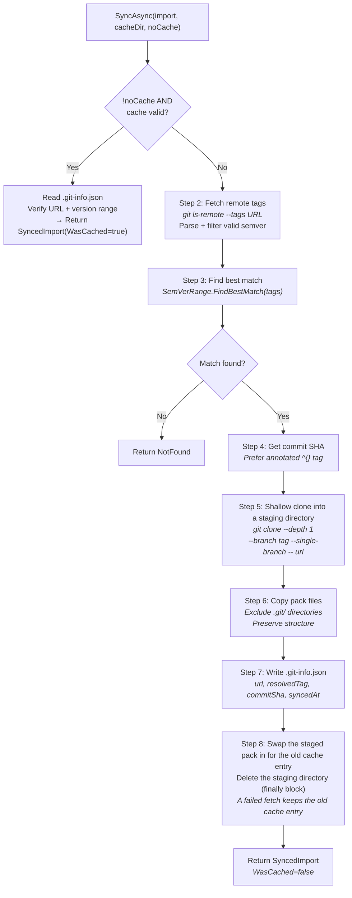

# Git Sync

The sync system allows teams to publish and consume rule packs via git repositories with semver-aware version resolution and local caching.

## Imports Manifest

**Interface:** `IImportsLoader`
**Implementation:** `ImportsYamlLoader`

Parses `.architecture/imports.yaml` files that define external pack dependencies.

```yaml
# .architecture/imports.yaml
imports:
  - name: company-standards
    type: git
    url: git@github.com:acme/architecture-packs.git
    path: packs/clean-architecture
    version: "^2.0"

  - name: team-conventions
    type: git
    url: https://github.com/acme/team-rules.git
    version: "1.3.0"
```

**ImportDefinition model:**

| Field | Type | Description |
|-------|------|-------------|
| `Name` | `string` | Import identifier (used in `import://name` references) |
| `Type` | `string` | Sync provider type (currently only `"git"` supported) |
| `Url` | `string` | Git repository URL (SSH or HTTPS) |
| `Path` | `string` | Subdirectory within repo containing the pack (default: `""` = root) |
| `Version` | `string` | Semver version or range (`"1.3.0"`, `"^2.0"`, `"~1.3"`) |

## SemVer Range Resolution

**Class:** `SemVerRange`

Parses version range strings and matches against available git tags.

**Supported range syntaxes:**

| Syntax | Meaning | Match Examples |
|--------|---------|----------------|
| `1.3.0` | Exact match | Only `1.3.0` |
| `^2.0` | Compatible (same major) | `2.0.0`, `2.1.0`, `2.9.9` — not `3.0.0` |
| `^0.3` | Compatible (same minor, major=0) | `0.3.0`, `0.3.5` — not `0.4.0` |
| `~1.3` | Approximately (same major.minor) | `1.3.0`, `1.3.9` — not `1.4.0` |
| `~1.3.2` | Approximately (same major.minor) | `1.3.2`, `1.3.9` — not `1.4.0` |

**SemVer parsing:**
- Regex: `^v?(\d+)\.(\d+)(?:\.(\d+))?$`
- Accepts optional `v` prefix (e.g., `v1.0.0`)
- Patch defaults to `0` if omitted (e.g., `1.3` → `1.3.0`)

**FindBestMatch algorithm:**



## GitCliSyncProvider

**Interface:** `IGitSyncProvider`
**Implementation:** `GitCliSyncProvider`

Performs the actual git operations to fetch and cache rule packs.

```
IGitSyncProvider
  └── SyncAsync(ImportDefinition import, string cacheDir, bool noCache, CancellationToken ct)
        → Task<Result<SyncedImport, AriadneError>>
```

`SyncedImport` holds `ImportName`, `ResolvedVersion`, `WasCached` and `CachePath`. A failure is an `AriadneError`:

| Failure | Code |
|---|---|
| Missing or unusable name, url or version, or a bad semver range | Invalid |
| A name that is not a plain directory name, or a `path` that leaves the repository or points into its `.git` folder, including through the NTFS short name `GIT~1` | Invalid |
| A `path` that does not exist in the repository at the resolved tag | NotFound |
| A symbolic link in the part of the repository that is copied, or on the way to `path` | Invalid |
| No tag satisfies the version range | NotFound |
| git fails, times out or exhausts its retries | Unavailable, with git's stderr or the policy failure as Detail |
| Reading or writing the cache fails | Unavailable, with the IO error as Detail |

**Full sync workflow:**



**Cache validation (IsCacheValid):**

1. Check cache directory exists
2. Read and parse `.git-info.json`
3. Verify URL matches exactly (Ordinal comparison of the urls with credentials redacted; `.git-info.json` never stores credentials, and a record written before redaction is rewritten redacted on a cache hit)
4. Parse cached version as SemVer
5. Check version still satisfies the requested range
6. Returns `false` if any check fails (graceful degradation)

**Git command execution (internal `IGitClient`):**

- `GitCliClient` uses `System.Diagnostics.Process` with `UseShellExecute=false`, `CreateNoWindow=true`
- Passes every argument separately through `ProcessStartInfo.ArgumentList`, with `--` before the url, so a url with spaces, quotes or a leading `-` cannot add git options
- Redirects stdout and stderr and reads both streams at once
- Replaces the userinfo of any url in its error text with `***`, so `https://token@host/x` is reported as `https://***@host/x`
- Throws `InvalidOperationException` on a non-zero exit code, with git's stderr in the message
- Kills git when the call is cancelled or times out
- Uses the caller's git credentials (SSH keys, credential managers)
- The container hands `GitCliSyncProvider` the generated ZeroAlloc.Resilience proxy around `GitCliClient`: up to 3 attempts with a 500 ms exponential backoff, and a 60 s timeout over the whole command. The proxy returns a thrown exception, a timeout or exhausted retries as a `ResilienceError`, which the provider reports as Unavailable. A caller's cancellation propagates as `OperationCanceledException` and is not retried.

## SyncOrchestrator

**Interface:** `ISyncOrchestrator`
**Implementation:** `SyncOrchestrator`

Orchestrates syncing of all or specific imports from the manifest.

```
ISyncOrchestrator
  ├── SyncAllAsync(manifest, cacheDir, noCache, ct) → Task<IReadOnlyList<ImportSyncOutcome>>
  └── SyncByNameAsync(manifest, name, cacheDir, noCache, ct) → Task<IReadOnlyList<ImportSyncOutcome>>
```

Each `ImportSyncOutcome` pairs an import name with its `Result<SyncedImport, AriadneError>`. One import failing does not stop the others.

**Type routing:** Only `"git"` type is supported. Other types give an Invalid outcome.

**SyncByNameAsync:** Finds the import by name (case-insensitive), and returns a single NotFound outcome if there is none.

---

Previous: [Validation and Linting](08-validation.md) | Next: [Host Applications](10-host-applications.md)
