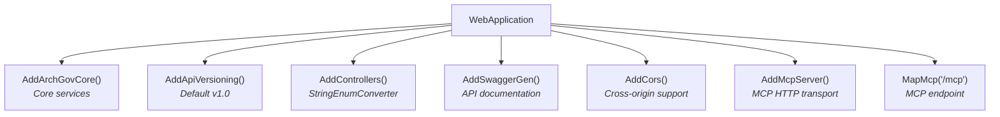
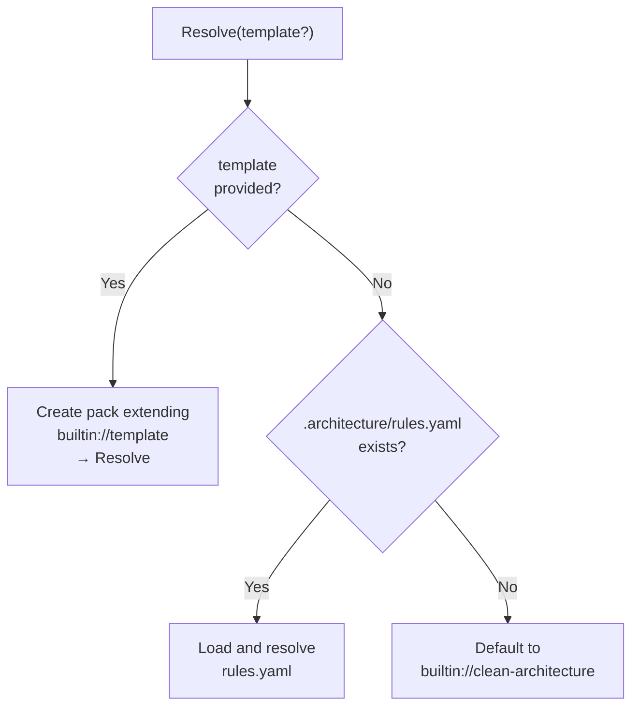

# Host Applications

The engine ships with three host applications, each targeting a different use case. All share the same core engine via `services.AddArchGovCore()`.

## CLI (ArchGov.Host.Cli)

Built with **System.CommandLine 3.0** (uses `Command`, `RootCommand`, `Option<T>` — no `Cli` prefix).

**Commands:**

### `init` — Initialize architecture rules

```bash
arch init --template clean-architecture
arch init --template clean-architecture+cqrs+ddd-tactical
```

- Splits template string by `+`
- Validates each pack name exists in the registry
- Creates `.architecture/rules.yaml` with `extends` list

### `rules` — Print resolved layer rules

```bash
arch rules
```

- Loads `.architecture/rules.yaml` from current directory
- Resolves all extends references
- Prints layers with their allowed dependencies

### `roles` — Print component roles table

```bash
arch roles
```

- Resolves rules, then prints a formatted table:
  `Name | Layer | TypeKind | RequiresInterface | Description`

### `generate` — Generate a component

```bash
arch generate --role Entity --name Order --solution MyApp --feature Orders
```

| Option | Short | Type | Description |
|--------|-------|------|-------------|
| `--role` | `-r` | `string` | Component role (e.g., `Entity`, `Repository`) |
| `--name` | `-n` | `string` | Component name (e.g., `Order`) |
| `--solution` | `-s` | `string` | Solution name |
| `--feature` | `-f` | `string` | Feature name |

Prints the generated file path, namespace, type name, and full source code.

### `validate` — Validate source code

```bash
arch validate ./src
arch validate /path/to/source
```

- Argument: `path` (default: `"./src"`)
- Validates directory exists
- Runs full two-pass validation
- Prints files scanned and any violations

### `lint` — Lint source code

```bash
arch lint ./src
```

- Argument: `path` (default: `"./src"`)
- Runs namespace-vs-directory consistency check
- Prints files scanned and any violations

### `sync` — Sync rule packs from git

```bash
arch sync                              # sync all imports
arch sync --name company-standards     # sync one import
arch sync --no-cache                   # force fresh fetch
```

| Option | Short | Type | Description |
|--------|-------|------|-------------|
| `--no-cache` | — | `bool` | Force fresh sync, ignore cache |
| `--name` | `-n` | `string?` | Sync only this import |

- Loads `.architecture/imports.yaml`
- Cache directory: `.architecture/.cache/git/`
- Prints import name, resolved version, and cached/fetched status

### Rules file resolution

All commands that need rules use `RulesCommand.ResolveRulesFromFile()`:

1. Look for `.architecture/rules.yaml` in the current directory
2. If not found, throw `FileNotFoundException` with helpful message
3. Load with `IRulePackLoader`
4. Resolve with `IRulePackResolver`
5. Return resolved `RulePack`

## REST API (ArchGov.Host.Api)

Built with **ASP.NET Core** with API versioning (Asp.Versioning, default v1.0) and Swagger.

**Middleware stack (Program.cs):**



**Endpoints (ArchitectureController + TemplatesController):**

| Method | Route | Query/Body | Returns |
|--------|-------|-----------|---------|
| GET | `/v1.0/architecture/templates` | — | `IEnumerable<string>` |
| GET | `/v1.0/architecture/layers` | `?template=clean-architecture` | `IList<LayerDefinition>` |
| GET | `/v1.0/architecture/component-roles` | `?template=clean-architecture` | `IList<ComponentRoleDefinition>` |
| GET | `/v1.0/architecture/rules` | `?template=clean-architecture` | `IList<CodeFeatureRuleDefinition>` |
| POST | `/v1.0/architecture/generate` | `ApiGenerateRequest` body | `GenerateResult` |
| POST | `/v1.0/architecture/validate` | `ApiValidateRequest` body | `SourceValidationResult` |
| POST | `/v1.0/architecture/lint` | `ApiValidateRequest` body | `LintResult` |
| POST | `/v1.0/architecture/generate-workspace` | `ApiWorkspaceRequest` body | `WorkspaceGenerateResult` |

**API request models:**

```
ApiGenerateRequest
  ├── SolutionName: string          (required)
  ├── Template: string?             (optional — defaults to clean-architecture)
  ├── Features: IList<string>?      (optional)
  └── Components: IList<ApiComponentRequest>  (required)
        ├── ComponentRole: string   (required)
        └── Name: string           (required)

ApiValidateRequest
  ├── SourceDirectory: string       (required)
  └── Template: string?             (optional)

ApiWorkspaceRequest
  ├── SolutionName: string          (required)
  ├── Template: string?             (optional)
  └── Features: IReadOnlyList<string>  (required)
```

## MCP Server (ArchGov.Host.Mcp)

Built with the **ModelContextProtocol SDK** for AI agent integration.

**Transports:**
- **Stdio** — local process communication (for Claude Code, Cursor, etc.)
- **HTTP** — remote access via the API server's `/mcp` endpoint

**RuleResolutionHelper** — shared logic for all MCP tools:



**MCP Tools:**

| Tool | Parameters | Returns | Description |
|------|-----------|---------|-------------|
| `list_templates` | — | `IReadOnlyList<string>` | List available templates |
| `get_layers` | `template?` | `IList<LayerDefinition>` | Layer definitions with dependencies |
| `get_component_roles` | `template?` | `IList<ComponentRoleDefinition>` | Available roles for code generation |
| `get_rules` | `template?` | `IList<CodeFeatureRuleDefinition>` | Structural enforcement rules |
| `generate_component` | `role`, `name`, `solution`, `feature`, `template?` | `GenerateResult` | Generate a C# component |
| `validate_source` | `sourceDirectory`, `template?` | `SourceValidationResult` | Validate against rules |
| `lint_source` | `sourceDirectory`, `template?` | `LintResult` | Lint for mismatches |

**MCP Resources:**

| URI Template | Returns | Description |
|-------------|---------|-------------|
| `archgov://packs/{name}` | Raw YAML string | Full content of a built-in pack |

All tools auto-detect `.architecture/rules.yaml` in the working directory. The `template` parameter overrides auto-detection.

---

Previous: [Git Sync](09-git-sync.md) | Next: [Dependency Injection](11-dependency-injection.md)
