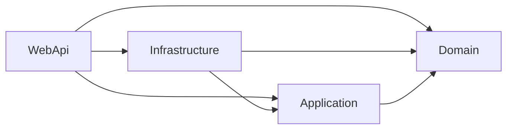
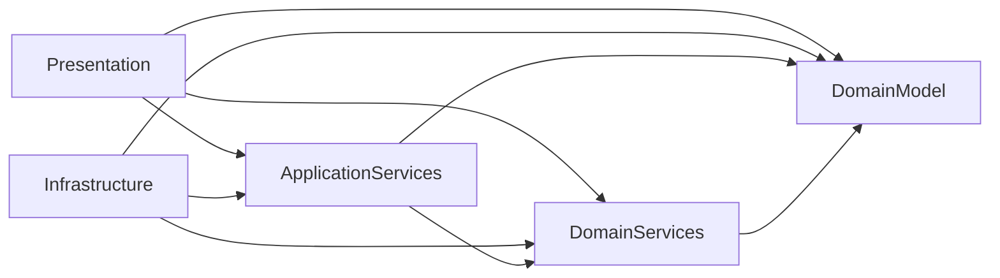
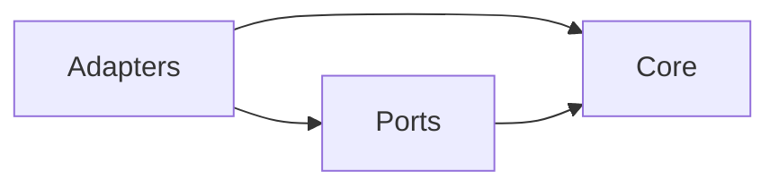
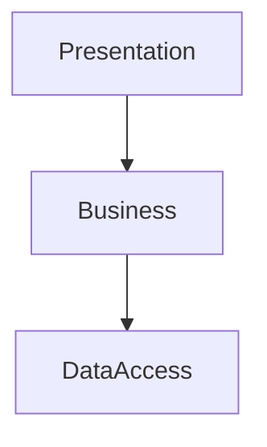
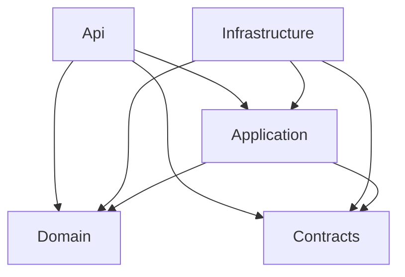
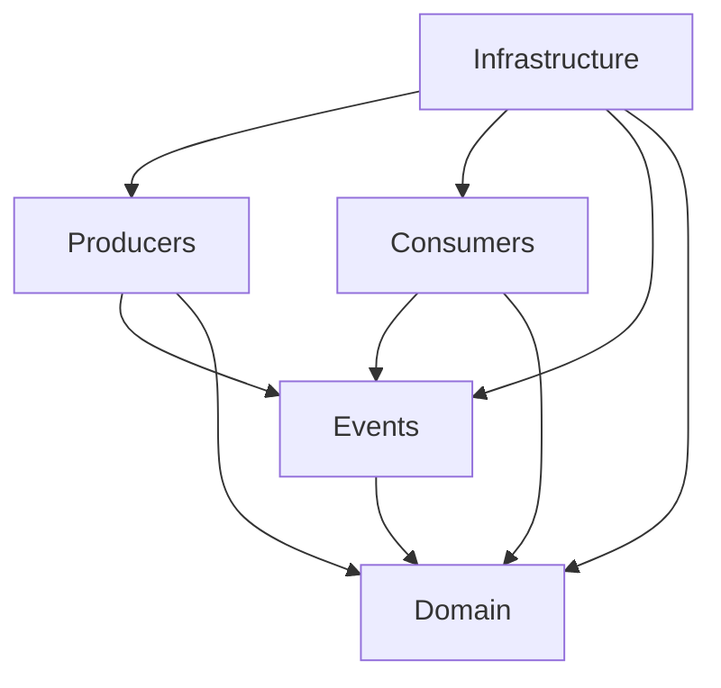
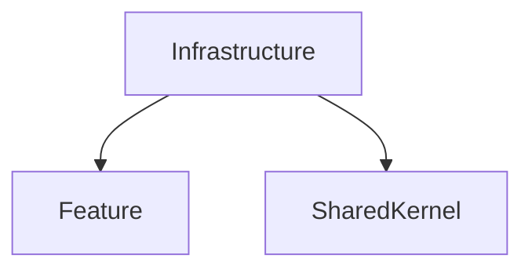
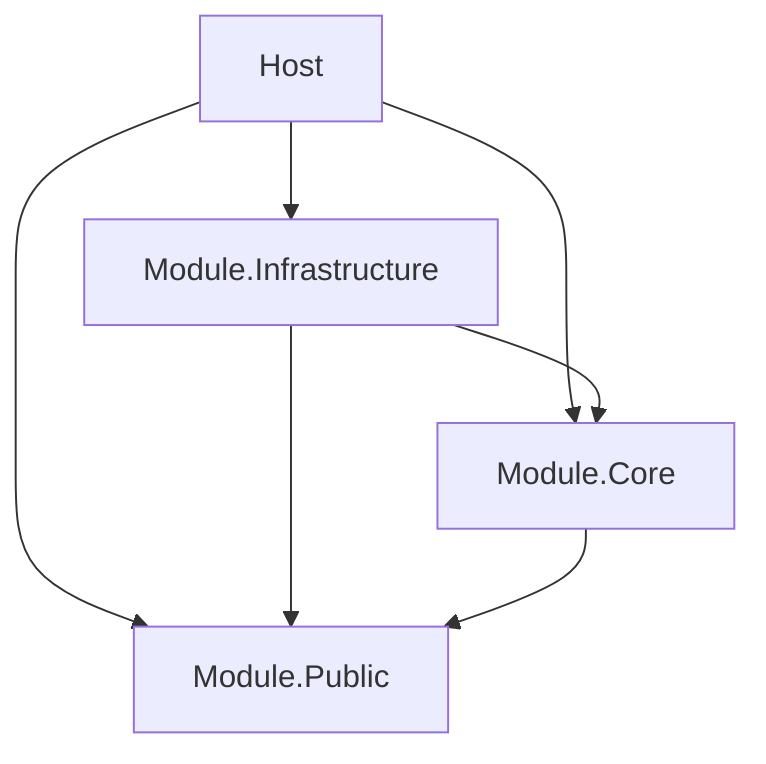

# Built-in Templates

Ten templates ship as embedded YAML resources. They fall into two categories:

## Standalone Templates

Standalone templates define their own layers and can be used independently.

### clean-architecture

4 layers, 19 roles. The classic Clean Architecture pattern (Robert C. Martin).

| Layer | Dependencies | Roles |
|-------|-------------|-------|
| Domain | *(none)* | Entity, ValueObject, DomainService, DomainServiceInterface, DomainEvent, Specification, RepositoryInterface |
| Application | Domain | CommandHandler, CommandHandlerInterface, QueryHandler, QueryHandlerInterface, Dto, Mapper, Validator, ExternalServiceInterface |
| Infrastructure | Domain, Application | Repository (internal), ExternalService (internal) |
| WebApi | Domain, Application, Infrastructure | Controller, Middleware |

Code feature rules: `CODE-001` (interface-required roles must have interfaces), `CODE-002` (implementations should be internal).



### onion-architecture

5 layers, 15 roles. Onion Architecture (Jeffrey Palermo).

| Layer | Dependencies | Key Roles |
|-------|-------------|-----------|
| DomainModel | *(none)* | Entity, ValueObject, DomainEnum |
| DomainServices | DomainModel | RepositoryInterface, DomainServiceInterface, DomainEvent |
| ApplicationServices | DomainModel, DomainServices | ApplicationService, ApplicationServiceInterface, Dto |
| Infrastructure | DomainModel, DomainServices, ApplicationServices | Repository (internal), DomainService (internal), DbContext |
| Presentation | DomainModel, DomainServices, ApplicationServices | Controller, ViewModel |



### hexagonal-architecture

3 layers, 7 roles. Ports & Adapters pattern (Alistair Cockburn).

| Layer | Dependencies | Key Roles |
|-------|-------------|-----------|
| Core | *(none)* | Entity, ValueObject, DomainService |
| Ports | Core | DrivingPort (Interface), DrivenPort (Interface) |
| Adapters | Core, Ports | PrimaryAdapter, SecondaryAdapter (internal) |



### layered

3 layers, 11 roles. Traditional N-tier / layered architecture.

| Layer | Dependencies | Key Roles |
|-------|-------------|-----------|
| Presentation | Business | Controller, ViewModel, ApiModel |
| Business | DataAccess | Service, ServiceInterface, Validator, BusinessModel |
| DataAccess | *(none)* | Repository, RepositoryInterface, DbContext, DataModel |

Note: dependency direction is **top-down** (Presentation → Business → DataAccess), unlike Clean Architecture where it flows inward.



### microservice

5 layers, 17 roles. Per-service microservice structure.

| Layer | Dependencies | Key Roles |
|-------|-------------|-----------|
| Domain | *(none)* | Entity, Aggregate, ValueObject, DomainEvent, RepositoryInterface |
| Application | Domain, Contracts | Handler, ApplicationService, ApplicationServiceInterface |
| Infrastructure | Domain, Application, Contracts | Repository (internal), DbContext, MessagePublisher, MessageConsumer |
| Api | Domain, Application, Contracts | Controller, GrpcService |
| Contracts | *(none)* | IntegrationEvent, ApiRequest, ApiResponse |

Note: `Contracts` is a leaf layer with no dependencies — it contains shared DTOs and integration events that other services can consume.



### event-driven

5 layers, 9 roles. Event-driven architecture.

| Layer | Dependencies | Key Roles |
|-------|-------------|-----------|
| Domain | *(none)* | *(inherits from composed packs)* |
| Events | Domain | Event, IntegrationEvent |
| Producers | Domain, Events | EventProducer, EventProducerInterface |
| Consumers | Domain, Events | EventConsumer, EventConsumerInterface, EventHandler |
| Infrastructure | Domain, Events, Producers, Consumers | MessageBrokerAdapter (internal), MessageBrokerInterface |



### vertical-slice

3 layers, 8 roles. Vertical slice / feature-based architecture.

| Layer | Dependencies | Key Roles |
|-------|-------------|-----------|
| Feature | *(none)* | Request, Response, Handler, Validator, Endpoint |
| SharedKernel | *(none)* | SharedEntity, SharedDto |
| Infrastructure | Feature, SharedKernel | DbContext |



### modular-monolith

4 layers, 8 roles. Modular monolith pattern.

| Layer | Dependencies | Key Roles |
|-------|-------------|-----------|
| Module.Public | *(none)* | ModuleContract (Interface), ModuleEvent, ModuleDto |
| Module.Core | Module.Public | ModuleService (internal), ModuleEntity, ModuleRepositoryInterface |
| Module.Infrastructure | Module.Public, Module.Core | ModuleRepository (internal) |
| Host | Module.Public, Module.Core, Module.Infrastructure | ModuleRegistration |



## Composable Add-on Templates

Add-on templates define only component roles (no layers). They are designed to be composed with standalone templates via the `extends` field.

### cqrs

7 roles. Command/Query Responsibility Segregation.

| Role | Layer | TypeKind |
|------|-------|----------|
| Command | Application | Record |
| CommandHandler | Application | Class (requires interface) |
| CommandHandlerInterface | Application | Interface |
| Query | Application | Record |
| QueryHandler | Application | Class (requires interface) |
| QueryHandlerInterface | Application | Interface |
| QueryResult | Application | Record |

**Usage:** `extends: [builtin://clean-architecture, builtin://cqrs]`

### ddd-tactical

9 roles. Domain-Driven Design tactical patterns.

| Role | Layer | TypeKind |
|------|-------|----------|
| Aggregate | Domain | Class |
| AggregateRoot | Domain | Class |
| ValueObject | Domain | Record |
| DomainEvent | Domain | Record |
| DomainService | Domain | Class (requires interface) |
| DomainServiceInterface | Domain | Interface |
| Specification | Domain | Class |
| Factory | Domain | Class |
| DomainException | Domain | Class |

**Usage:** `extends: [builtin://clean-architecture, builtin://ddd-tactical]`

## Composing Templates

Templates compose via the merge algorithm described in [Rule Engine](05-rule-engine.md):

```yaml
# .architecture/rules.yaml
name: my-project
extends:
  - builtin://clean-architecture    # base: 4 layers, 19 roles
  - builtin://cqrs                  # add-on: +7 roles
  - builtin://ddd-tactical          # add-on: +9 roles (some overlap)

# Team-specific additions
componentRoles:
  - name: OutboxMessage
    layer: Infrastructure
    typeKind: Class
```

The `cqrs` and `ddd-tactical` roles name the Application and Domain layers but declare no layers of their own, so combine them with a base pack that declares those layers.

The resolved pack will have:
- **Name:** `"clean-architecture+cqrs+ddd-tactical+my-project"`
- **Layers:** 4 (from clean-architecture, unmodified since add-ons define no layers)
- **Roles:** ~30 (19 + 7 + 9, minus overlaps where later packs override)
- **Rules:** 2 (from clean-architecture, locked — cannot be overridden)

---

Previous: [Dependency Injection](11-dependency-injection.md)
