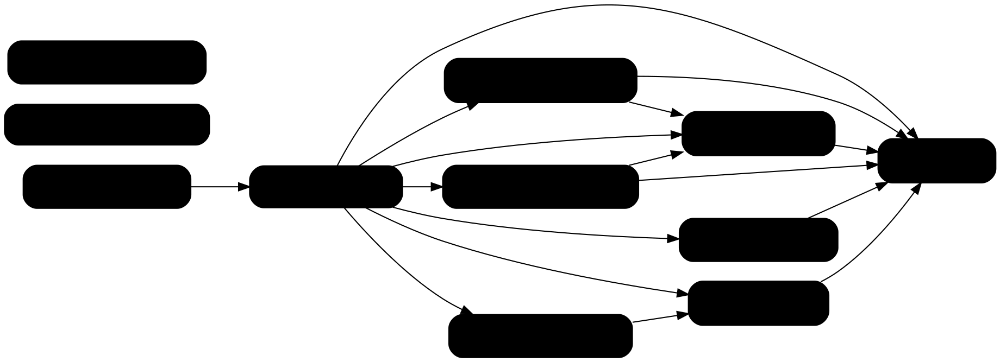

# Impact Analysis: Phase 1.1 — Rename to Ariadne.NET

Design: `docs/superpowers/specs/2026-10-31-phase-1.1-rename-design.md`

## Summary

| Metric | Value |
|---|---|
| Date | 2026-10-31 |
| Refactor Type | Rename (projects, folders, namespaces, package ID) plus move (folder paths) |
| Targets | 8 project/solution names, 2 ZInject-generated methods, 7 user-visible string families |
| Directly Affected Files | 130 |
| Transitively Affected Files | 0 beyond the direct set (see Transitive Closure) |
| Total Affected Files | 130 (80 src, 33 tests, 14 docs, 3 repo config) |
| Breaking Changes | 113 files (every src and tests file that declares or uses an `ArchGov.*` namespace or project path) |
| Risks Identified | 8 |
| Risk Level | High by count (more than 50 files); the change itself is mechanical and fully compiler- and test-checked apart from the risks below |

**Baseline (2026-10-31, before the rename):** `dotnet build src/ArchGov.slnx` succeeds with 27 warnings and 0 errors; `dotnet test` passes 224 Core, 25 Mcp and 9 Cli tests (258).

## Targets

| # | Old | New | Kind |
|---|---|---|---|
| T1 | `ArchGov.Core` (project, folder, assembly, namespace root, PackageId) | `Ariadne.NET` | Rename + move |
| T2 | `ArchGov.Host.Mcp` | `Ariadne.NET.Mcp` | Rename + move |
| T3 | `ArchGov.Host.Cli` | `Ariadne.NET.Cli` | Rename + move |
| T4 | `ArchGov.Host.Api` (incl. `ArchGov.Host.Api.http`) | `Ariadne.NET.Mcp.Http` | Rename + move |
| T5 | `ArchGov.Core.Tests` | `Ariadne.NET.Tests` | Rename + move |
| T6 | `ArchGov.Host.Mcp.Tests` | `Ariadne.NET.Mcp.Tests` | Rename + move |
| T7 | `ArchGov.Host.Cli.Tests` | `Ariadne.NET.Cli.Tests` | Rename + move |
| T8 | `src/ArchGov.slnx` | `src/Ariadne.NET.slnx` | Rename |
| T9 | `AddArchGovCoreServices` (ZInject-generated) | `AddAriadneNETServices` | Follows T1 |
| T10 | `AddArchGovHostMcpServices` (ZInject-generated) | `AddAriadneNETMcpServices` | Follows T2 |
| S1 | `archgov://packs/{name}` | `ariadne://packs/{name}` | String |
| S2 | MCP server key `"archgov"` in config examples | `"ariadne"` | Docs string |
| S3 | `'archgov sync'` in error messages | `'ariadne sync'` | String |
| S4 | `ARCHGOV-001`/`002`, author `archgov-team` | `ARIADNE-001`/`002`, `ariadne` | YAML |
| S5 | Temp-directory prefixes `archgov-*` | `ariadne-*` | String |
| S6 | Docusaurus navbar title `ArchGov`; site title and README H1 `Architecture Governance Engine` | `Ariadne.NET` (the descriptive phrase stays in the tagline and first sentence) | Docs |
| S7 | Prose `ArchGov…` in README, CLAUDE.md, `docs/`, `docs-site/docs/` | the new names | Docs |

**ZInject naming rule, verified:** the generator names the method `Add` + the assembly name without dots + `Services`. Confirmed from the generated source (`ArchGov.Host.Mcp` → `AddArchGovHostMcpServices`) and from Rag.NET (`Rag.NET` → `AddRagNETServices`). T9 and T10 therefore change by themselves when the assemblies are renamed; only their call sites need editing.

## Dependency Graph

Red = Breaking, yellow = Test Impact, orange = Update Required, gray = Cosmetic/docs.

## Transitive Closure

Every consumer of a renamed namespace is itself inside the solution and already in the direct set. Nothing outside the repo consumes these assemblies: no NuGet package was published, `publish.yml` cannot run because Actions are disabled, and the sibling repos do not reference ArchGov. The closure therefore ends after round 1. Public API names change only by namespace and the two generated extension methods; no signatures change.

## Affected Files

Grouped by kind rather than listed one file per row, because every row in a group needs the same mechanical edit.

| # | Files | Classification | Change Required | Caused By | Complexity |
|---|---|---|---|---|---|
| 1 | `src/ArchGov.Core/**` (57: 56 `.cs` + csproj) | Breaking | Folder and csproj move; `namespace`/`using ArchGov.Core…` → `Ariadne.NET…`; PackageId → `Ariadne.NET` | T1 | Trivial |
| 2 | `src/ArchGov.Host.Mcp/**` (8) | Breaking | Move; namespaces; ProjectReference path; `AddArchGovCoreServices`/`AddArchGovHostMcpServices` calls in `Program.cs` | T1, T2, T9, T10 | Trivial |
| 3 | `src/ArchGov.Host.Cli/**` (11) | Breaking | Move; namespaces; ProjectReference; `AddArchGovCoreServices` call | T1, T3, T9 | Trivial |
| 4 | `src/ArchGov.Host.Api/**` (`Program.cs`, csproj, `.http`) | Breaking | Move to `Ariadne.NET.Mcp.Http`; `namespace` → `Ariadne.NET.Mcp.Http`; ProjectReferences; `typeof(ArchGov.Host.Mcp…)` → `Ariadne.NET.Mcp…`; both `Add…Services` calls; `.http` variable name. The `.http` file still calls `/weatherforecast/`, which no longer exists; point it at `/mcp` (pre-existing defect in a touched file) | T1, T2, T4, T9, T10 | Trivial |
| 5 | `src/ArchGov.slnx` | Breaking | Rename; all seven project paths | T1–T8 | Trivial |
| 6 | `tests/ArchGov.Core.Tests/**` (25) | Test Impact (breaking at compile) | Move; namespaces; ProjectReference; `AddArchGovCoreServices` in `ServiceRegistrationTests`; `archgov-*` temp prefixes | T1, T5, T9, S5 | Trivial |
| 7 | `tests/ArchGov.Host.Mcp.Tests/**` (6) | Test Impact | Move; namespaces; ProjectReferences; `archgov://` URI assertions in `PackResourcesTests` | T2, T6, S1 | Trivial |
| 8 | `tests/ArchGov.Host.Cli.Tests/**` (2) | Test Impact | Move; namespaces; ProjectReference; `AddArchGovCoreServices` in `ExitCodeTests` | T3, T7, T9 | Trivial |
| 9 | `src/ArchGov.Host.Mcp/Resources/PackResources.cs` | Breaking (runtime) | `UriTemplate = "archgov://…"` → `ariadne://…`; must change together with row 7's assertions | S1 | Trivial |
| 10 | `src/ArchGov.Core/RuleLoader/RulePackResolver.cs` | Update Required | Three messages `'archgov sync'` → `'ariadne sync'` | S3 | Trivial |
| 11 | `src/ArchGov.Core/RuleLoader/BuiltinPackRegistry.cs` | Cosmetic | Comment showing the resource name; logic unaffected | T1 | Trivial |
| 12 | `.github/workflows/ci.yml`, `publish.yml` | Update Required | `src/ArchGov.slnx` → `src/Ariadne.NET.slnx` (7 lines) | T8 | Trivial |
| 13 | `.architecture/rules.yaml` | Update Required | `ARCHGOV-001/002` → `ARIADNE-001/002`; author → `ariadne` | S4 | Trivial |
| 14 | `docs-site/docusaurus.config.js` | Update Required | Site title and navbar title → `Ariadne.NET`. Repo URLs, `baseUrl` and `projectName` stay until the repo is renamed in Phase 1.4 | S6 | Trivial |
| 15 | `README.md` | Update Required | H1 → `Ariadne.NET`; MCP config key `"archgov"`; `archgov://`; project paths and layout tree; `dotnet run --project` paths | S2, S6, S7, T1–T4 | Trivial |
| 16 | `CLAUDE.md` | Update Required | Commands, project list, ZInject method names, slnx path | T1–T10 | Moderate (re-read the sentences, e.g. the `Host.Api` explanation) |
| 17 | `docs/features.md`, `docs/how-it-works.md`, `docs/how-it-works/*` (5) | Cosmetic | Project names, `archgov://`, Mermaid node labels | S1, S7 | Trivial |
| 18 | `docs-site/docs/**` (6) | Cosmetic | Same as row 17, plus the MCP config key in `index.md` | S1, S2, S7 | Trivial |

**Not changed:** `docs/plans/*` (historical), `docs/planning/*` (history; the ROADMAP/MILESTONE wording "No `ArchGov` names remain" is a criterion, not a stale name), `docs/superpowers/specs/*` (name the old identifiers on purpose), `Directory.Build.props` and `GitVersion.yml` (no hits), `.architecture/` folder name.

## Risk Register

| # | Risk | Affected Files | Severity | Mitigation |
|---|---|---|---|---|
| 1 | **Untracked `bin/`/`obj/` stay behind.** `git mv` moves only tracked files, so the old `src/ArchGov.*/bin` and `obj` folders remain, and stale generated code (ZInject, AssemblyInfo) under the old names could confuse a build or be globbed | all 7 project folders | High | Delete `bin`/`obj` under every old folder before the move (`dotnet clean` is not enough), then confirm no `src/ArchGov.*` or `tests/ArchGov.*` directory is left |
| 2 | **Replacement order.** A general rule applied before a specific one produces wrong names, e.g. `ArchGov.Host.Api` → `Ariadne.NET.Api` instead of `Ariadne.NET.Mcp.Http` | src, tests, docs | High | Fixed order, most specific first (see Execution Order); afterwards `git grep -E 'Ariadne\.NET\.(Host|Core|Api)\b'` must be empty |
| 3 | **Embedded-resource names change** from `ArchGov.Core.BuiltinPacks.<name>.yaml` to `Ariadne.NET.BuiltinPacks.<name>.yaml` (dynamic, by convention) | `BuiltinPackRegistry.cs` | Medium | `ExtractPackName` takes the segment after the last dot before `.yaml`, so it is prefix-independent. `BuiltinPackRegistryTests.GetAvailablePacks_ShouldReturnAllBuiltinPacks` and the per-pack load tests guard it |
| 4 | **ZInject-generated names** are not in the source, so they are not caught by a text search of the generator's own output | Program.cs ×3, ServiceRegistrationTests, ExitCodeTests | Medium | The naming rule is verified (see Targets); the build fails if a call site is missed |
| 5 | **MCP resource URI is a contract** for MCP clients | PackResources.cs, PackResourcesTests, docs | Medium | No external client exists yet (nothing published). Change code, tests and docs in one commit |
| 6 | **High fan-in on `ArchGov.Core` namespaces** (used by all hosts and tests) | 113 files | Medium | Move and namespace replacement are one atomic group; build and test only at its end |
| 7 | **Namespace shadowing** from new segments `NET`, `Mcp`, `Http`, `Cli` (e.g. `Http.` resolving to `Ariadne.NET.Mcp.Http` inside that namespace) | `Ariadne.NET.Mcp.Http`, `Ariadne.NET.Mcp` | Low | No source uses an unqualified `Http.`, `Mcp.`, `Cli.` or `Tests.` prefix today (checked). The build catches any new case |
| 8 | **The main worktree has `fix/mcp-composite-template` checked out** | git only | Low | Work in this worktree and push with `git push -u origin HEAD:fix/mcp-composite-template`; the main checkout fast-forwards when it next pulls |

**Cross-boundary:** none. No external consumers, no database or serialized state carrying the name, and the repo URL in docs and Docusaurus is deliberately unchanged until Phase 1.4.

## Execution Order

### Group 1: Move projects and rename namespaces (ATOMIC)

The codebase does not build between the move and the replacement, so this is one commit.

1. Delete `bin/` and `obj/` under every `src/ArchGov.*` and `tests/ArchGov.*` folder (Risk 1).
2. `git mv` the seven project folders, then each `.csproj` inside them, `ArchGov.Host.Api.http`, and `src/ArchGov.slnx` → `src/Ariadne.NET.slnx`.
3. Text replacement over `src/`, `tests/` and `.github/workflows/`, in this order:
   1. `ArchGov.Host.Api` → `Ariadne.NET.Mcp.Http`
   2. `ArchGov.Host.` → `Ariadne.NET.`
   3. `ArchGov.Core.Tests` → `Ariadne.NET.Tests`
   4. `ArchGov.Core` → `Ariadne.NET`
   5. `ArchGov.slnx` → `Ariadne.NET.slnx`
   6. `AddArchGovHostMcpServices` → `AddAriadneNETMcpServices`
   7. `AddArchGovCoreServices` → `AddAriadneNETServices`
4. **Checkpoint:**
   - `dotnet build src/Ariadne.NET.slnx`: 0 errors, no warnings beyond the baseline 27.
   - `dotnet test`: 258 passing.
   - `git grep -E 'Ariadne\.NET\.(Host|Core|Api)\b'` is empty.
   - No `ArchGov.*` directory left.
   - Commit.

### Group 2: User-visible strings in code and config

Rows 4 (`.http`), 9, 10, 11, 13 and the S5 prefixes in tests. Change S1 in `PackResources.cs` and `PackResourcesTests` together.

- `archgov://` → `ariadne://`
- `'archgov sync'` → `'ariadne sync'`
- `archgov-` temp prefixes → `ariadne-`
- `ARCHGOV-` → `ARIADNE-`
- `archgov-team` → `ariadne`
- `.http`: rename the variable and point the request at `/mcp`
- Fix the `BuiltinPackRegistry` comment

- **Checkpoint:** build, 258 tests, `git grep -i archgov -- src tests .github .architecture` empty, commit.

### Group 3: Docs

Rows 14–18:
- the same ordered replacement as Group 1;
- then the S1/S2 strings;
- the README H1 and Docusaurus titles.

Then read README, CLAUDE.md and the architecture pages once for sentences that only made sense under the old name.

- **Checkpoint:** the full gate `git grep -i archgov -- . ':!docs/plans' ':!docs/planning' ':!docs/superpowers'` is empty; `npm run build` in `docs-site/` if Node is available (broken Mermaid labels or links show there); commit.

### Group 4: Smoke run

- `dotnet run --project src/Ariadne.NET.Cli` with a command that loads a built-in pack (for example validating this repo's own `.architecture/rules.yaml`).
- Start `Ariadne.NET.Mcp` and read `ariadne://packs/clean-architecture`, or rely on `PackResourcesTests` if a manual MCP session is impractical.

- **Checkpoint:** exit code 0 or 1 as appropriate (not 2); record the result in the plan.
