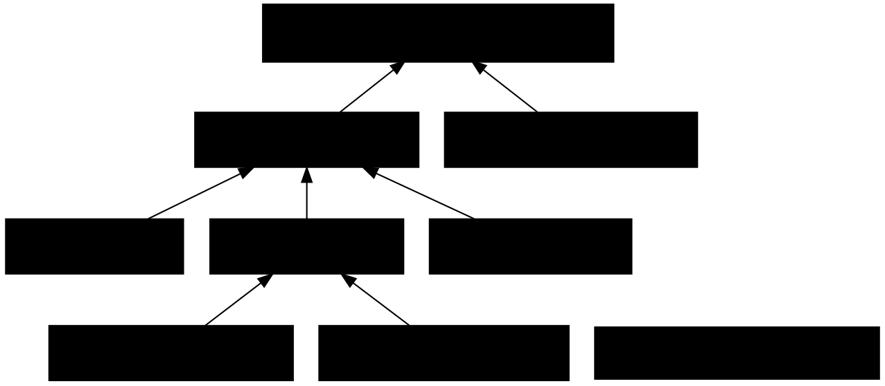

# Impact Analysis: Phase 1.2 — Package split

Design: `docs/superpowers/specs/2026-10-31-phase-1.2-package-split-design.md`

## Summary

| Metric | Value |
|---|---|
| Date | 2026-10-31 |
| Refactor Type | Move (to a new assembly) + namespace rename; Extract (new projects) |
| Targets | 9 moved files + 3 new projects (Abstractions, AotSmoke, and the slnx entry) |
| Directly Affected Files | 38 (20 engine, 6 surfaces, 12 tests) |
| Transitively Affected Files | 0 — no signatures change, only namespaces and the assembly |
| Total Affected Files | 54 (9 moved, 38 using-updates, 5 project/solution files, 2 docs) |
| Breaking Changes | 47 (every file that names a moved type fails to compile until its `using` changes) |
| Risks Identified | 5 (none high severity) |
| Risk Level | High by the >50-file rule; in practice mechanical — 47 of the edits are one `using` line each, enforced by the compiler |

The transitive closure stops at depth 1: moved types keep their names, members and signatures. Only their namespace (`Ariadne.NET.RuleSchema` / `Ariadne.NET.RuleLoader` → `Ariadne.NET.Abstractions`) and their assembly change. No file's public interface changes as a result of updating a `using`.

## Dependency Graph

\* `Ariadne.NET.Mcp.Tests` imports `Ariadne.NET.RuleLoader` only for the concrete classes that stay (`BuiltinPackRegistry`, `RulePackResolver`, `YamlRulePackLoader`), so it needs no change.

## Affected Files

The `using` rule for every file below: replace `using Ariadne.NET.RuleSchema;` with `using Ariadne.NET.Abstractions;`. For `using Ariadne.NET.RuleLoader;`, keep it if the file names a class that stays (`YamlRulePackLoader`, `RulePackResolver`, `BuiltinPackRegistry`, `TemplateReference`), add `using Ariadne.NET.Abstractions;` if it names a moved interface, and drop the RuleLoader using if it named only moved interfaces. Keep `using` lines sorted.

### Targets (move with `git mv`, namespace → `Ariadne.NET.Abstractions`)

| # | File | Classification | Change Required | Complexity |
|---|---|---|---|---|
| 1 | `src/Ariadne.NET/RuleSchema/RulePack.cs` → `src/Ariadne.NET.Abstractions/RulePack.cs` | Breaking | Move; namespace | Trivial |
| 2 | `RuleSchema/LayerDefinition.cs` → same | Breaking | Move; namespace | Trivial |
| 3 | `RuleSchema/ComponentRoleDefinition.cs` → same | Breaking | Move; namespace | Trivial |
| 4 | `RuleSchema/CodeFeatureRuleDefinition.cs` → same | Breaking | Move; namespace | Trivial |
| 5 | `RuleSchema/NamingConventions.cs` → same | Breaking | Move; namespace | Trivial |
| 6 | `RuleSchema/CSharpTypeKind.cs` → same | Breaking | Move; namespace | Trivial |
| 7 | `RuleLoader/IRulePackLoader.cs` → `src/Ariadne.NET.Abstractions/IRulePackLoader.cs` | Breaking | Move; namespace; drop `using …RuleSchema` (same namespace now) | Trivial |
| 8 | `RuleLoader/IRulePackResolver.cs` → same | Breaking | As 7 | Trivial |
| 9 | `RuleLoader/IBuiltinPackRegistry.cs` → same | Breaking | As 7 | Trivial |

Flat layout: Abstractions has no subfolders, matching its single namespace (Mnemosyne's `Records/` subfolder is the exception, not the rule; with nine files there is nothing to group). *(Claude's call.)*

### Project and solution files

| # | File | Classification | Change Required | Complexity |
|---|---|---|---|---|
| 10 | `src/Ariadne.NET.Abstractions/Ariadne.NET.Abstractions.csproj` | New | net10.0, nullable, implicit usings, `IsAotCompatible`, PackageId, metadata copied from the engine with its own Description, `README.md` packed. No package references | Trivial |
| 11 | `src/Ariadne.NET/Ariadne.NET.csproj` | Breaking | Add `ProjectReference` to Abstractions | Trivial |
| 12 | `src/Ariadne.NET.slnx` | Update Required | Add Abstractions and AotSmoke | Trivial |
| 13 | `tests/Ariadne.NET.AotSmoke/Ariadne.NET.AotSmoke.csproj` | New | Exe, `PublishAot`, `IsPackable=false`, `ProjectReference` to Abstractions only | Trivial |
| 14 | `tests/Ariadne.NET.AotSmoke/Program.cs` | New | Build a `RulePack` with one layer and one component role; print a summary; exit 0 | Trivial |

### Engine (`src/Ariadne.NET/`) — Breaking, trivial `using` swap

| # | File | Caused By |
|---|---|---|
| 15 | `CodeGeneration/CodeGeneratorService.cs` | RuleSchema |
| 16 | `CodeGeneration/ICodeGeneratorService.cs` | RuleSchema |
| 17 | `Orchestration/GenerateOrchestrator.cs` | RuleSchema |
| 18 | `Orchestration/IGenerateOrchestrator.cs` | RuleSchema |
| 19 | `Orchestration/IWorkspaceOrchestrator.cs` | RuleSchema |
| 20 | `Orchestration/WorkspaceOrchestrator.cs` | RuleSchema |
| 21 | `RuleEngine/DependencyValidator.cs` | RuleSchema |
| 22 | `RuleEngine/IDependencyValidator.cs` | RuleSchema |
| 23 | `RuleEngine/ILayerInferenceEngine.cs` | RuleSchema |
| 24 | `RuleEngine/IRulePackMerger.cs` | RuleSchema |
| 25 | `RuleEngine/LayerInferenceEngine.cs` | RuleSchema |
| 26 | `RuleEngine/MergeResult.cs` | RuleSchema |
| 27 | `RuleEngine/RulePackMerger.cs` | RuleSchema |
| 28 | `RuleLoader/BuiltinPackRegistry.cs` | RuleSchema; implements `IBuiltinPackRegistry` (was same-namespace, now needs the using) |
| 29 | `RuleLoader/RulePackResolver.cs` | RuleSchema; implements `IRulePackResolver`, takes `IBuiltinPackRegistry` and `IRulePackLoader` |
| 30 | `RuleLoader/YamlRulePackLoader.cs` | RuleSchema; implements `IRulePackLoader` |
| 31 | `Validation/ILinter.cs` | RuleSchema |
| 32 | `Validation/ISourceValidator.cs` | RuleSchema |
| 33 | `Validation/Linter.cs` | RuleSchema |
| 34 | `Validation/SourceValidator.cs` | RuleSchema |

### Surfaces — Breaking, trivial `using` swap

| # | File | Caused By | RuleLoader using |
|---|---|---|---|
| 35 | `src/Ariadne.NET.Cli/Commands/RulesCommand.cs` | RuleSchema; `IRulePackLoader`, `IRulePackResolver` | Drop (moved interfaces only) |
| 36 | `src/Ariadne.NET.Cli/Commands/InitCommand.cs` | `IBuiltinPackRegistry` | Keep (`TemplateReference`) |
| 37 | `src/Ariadne.NET.Mcp/RuleResolutionHelper.cs` | RuleSchema; all three interfaces | Keep (`TemplateReference`) |
| 38 | `src/Ariadne.NET.Mcp/Tools/RuleTools.cs` | RuleSchema | — |
| 39 | `src/Ariadne.NET.Mcp/Tools/TemplateTools.cs` | RuleSchema; `IBuiltinPackRegistry` | Drop |
| 40 | `src/Ariadne.NET.Mcp/Resources/PackResources.cs` | `IBuiltinPackRegistry` | Keep (`BuiltinPackRegistry`) |

`src/Ariadne.NET.Mcp.Http/Program.cs` names only Mcp types: unaffected.

### Tests (`tests/Ariadne.NET.Tests/`) — Test Impact, trivial

| # | File | Change |
|---|---|---|
| 41 | `CodeGeneration/CodeGeneratorServiceTests.cs` | using swap |
| 42 | `Orchestration/GenerateOrchestratorTests.cs` | using swap |
| 43 | `Orchestration/WorkspaceOrchestratorTests.cs` | using swap (keeps RuleLoader) |
| 44 | `RuleEngine/DependencyValidatorTests.cs` | using swap |
| 45 | `RuleEngine/LayerInferenceEngineTests.cs` | using swap |
| 46 | `RuleEngine/RulePackMergerTests.cs` | using swap |
| 47 | `RuleLoader/RulePackResolverTests.cs` | using swap (keeps RuleLoader) |
| 48 | `RuleLoader/YamlRulePackLoaderTests.cs` | using swap (keeps RuleLoader) |
| 49 | `RuleSchema/RulePackTests.cs` → `Abstractions/RulePackTests.cs` | `git mv`; namespace `Ariadne.NET.Tests.Abstractions`; using swap — test folders mirror source namespaces (CLAUDE.md) *(Claude's call)* |
| 50 | `Validation/LinterTests.cs` | using swap |
| 51 | `Validation/SourceValidatorTests.cs` | using swap |
| 52 | `ServiceRegistrationTests.cs` | resolves all three moved interfaces: replace RuleLoader using with Abstractions |

### Docs — Update Required / Cosmetic

| # | File | Change |
|---|---|---|
| 53 | `CLAUDE.md` | Projects list: add `Ariadne.NET.Abstractions` (schema + pack contracts, no dependencies, AOT-compatible, packable); engine is no longer "the only packable project"; mention `tests/Ariadne.NET.AotSmoke` and its publish command under Commands |
| 54 | `README.md` | Architecture tree (lines ~252–271): add `Ariadne.NET.Abstractions/`, drop `RuleSchema/` from the engine, reword `RuleLoader/`; add AotSmoke under `tests/` |

`docs/features.md` lists only the surfaces: no change.

## Risk Register

| # | Risk | Affected Files | Severity | Mitigation |
|---|---|---|---|---|
| 1 | ZInject stops registering engine services against interfaces now defined in another assembly | `ServiceRegistrationTests.cs`, all DI consumers | Medium | Verified in the ZeroAlloc.Inject generator source: it collects `typeSymbol.AllInterfaces`, filtering only well-known system interfaces, with no assembly check. `ServiceRegistrationTests` resolves all three interfaces and confirms it at the checkpoint |
| 2 | Reflection or string-based type lookup by namespace | `BuiltinPackRegistry.cs`, `PackResources.cs`, `Mcp/Program.cs`, `Mcp.Http/Program.cs` | Low | Checked: every `.Assembly` lookup anchors on `BuiltinPackRegistry` or Mcp tool types, none of which move. No string literal contains `RuleSchema` or `RuleLoader` in `src/` |
| 3 | Embedded resource names change | `BuiltinPacks/*.yaml`, `BuiltinPackRegistry.cs` | Low | The packs and the registry stay in the engine assembly with the same root namespace; `BuiltinPackRegistryTests` and the built-in integration tests cover it |
| 4 | The analyzers from `Directory.Build.props` leak into the Abstractions nuspec as dependencies, or ZInject is added by habit | `Ariadne.NET.Abstractions.csproj` | Low | All analyzers there are `PrivateAssets=all`. Check the packed `.nuspec` has no `<dependencies>` entries at the pack checkpoint |
| 5 | The AotSmoke app ships as a NuGet package, because CI and publish run `dotnet pack` on the whole solution | `.github/workflows/ci.yml`, `publish.yml`, AotSmoke csproj | Low | `IsPackable=false`; the pack checkpoint lists the produced `.nupkg` files |

No circular dependencies: Abstractions references nothing; the graph is a tree. High fan-in: `RulePack` (35 files), but each needs only the namespace change, which the compiler enforces. No serialized state names a CLR namespace: the YAML packs are deserialized by property name.

## Execution Order

### Group 1: Create the empty Abstractions project
- `src/Ariadne.NET.Abstractions/Ariadne.NET.Abstractions.csproj` — new
- `src/Ariadne.NET.slnx` — add it
- **Checkpoint:** `dotnet build src/Ariadne.NET.slnx` succeeds; commit

### Group 2: Move the types and repoint every consumer (ATOMIC)
The namespace change breaks every consumer at once, so this group cannot be split and still compile.
- `git mv` the 9 target files (#1–9); set namespace `Ariadne.NET.Abstractions`
- `src/Ariadne.NET/Ariadne.NET.csproj` — `ProjectReference` to Abstractions (#11)
- Engine `using` swaps (#15–34)
- Surface `using` swaps (#35–40)
- Test `using` swaps (#41–52), including the `RulePackTests` folder move
- **Checkpoint:** `dotnet build src/Ariadne.NET.slnx --no-incremental` — no new warnings over the 27 baseline; `dotnet test src/Ariadne.NET.slnx` — 261 passing; `git grep -n 'Ariadne.NET.RuleSchema'` empty outside `docs/`; commit

### Group 3: AOT smoke app
- `tests/Ariadne.NET.AotSmoke/` (#13–14), added to the slnx
- **Checkpoint:** `dotnet publish tests/Ariadne.NET.AotSmoke -c Release -r linux-x64 -p:PublishAot=true -warnaserror` succeeds and the binary exits 0; commit

### Group 4: Packaging check
- No file changes expected
- **Checkpoint:** `dotnet pack src/Ariadne.NET.slnx -c Release -o <tmp>` produces `Ariadne.NET.Abstractions` and `Ariadne.NET` packages and no AotSmoke package; the Abstractions `.nuspec` has no dependencies; the engine `.nuspec` depends on `Ariadne.NET.Abstractions`

### Group 5: Docs
- `CLAUDE.md` (#53), `README.md` (#54)
- **Checkpoint:** read through; commit
