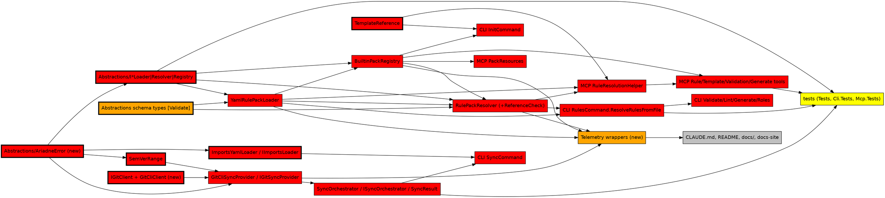

# Impact Analysis: Phase 1.3 — Family conventions

Design: `docs/superpowers/specs/2026-10-31-phase-1.3-family-conventions-design.md`

## Summary

| Metric | Value |
|---|---|
| Date | 2026-10-31 11:00 |
| Refactor Type | Change interface (Results), package migration (Inject), architectural additions (Validation, Telemetry, Resilience) |
| Targets | 10 (confirmed with the user) |
| Directly Affected Files | 52 |
| Transitively Affected Files | 14 |
| Total Affected Files | 66 (about 15 of them new) |
| Breaking Changes | 31 files fail to compile until updated |
| Risks Identified | 9 |
| Risk Level | **High**: more than 50 files, and two high-severity risks (an external consumer of Abstractions later, generated-proxy and DI composition) |

The file count is high because the Inject migration touches 17 files mechanically (one `using` line each), and the analyzer fixes touch about 10 test files. The semantic change is concentrated in about 20 files: `RuleLoader/`, `Sync/`, the CLI resolution path and the MCP resolution path.

## Targets

| # | Target | Type |
|---|---|---|
| T1 | ZInject 0.10.5 → ZeroAlloc.Inject 1.11.x | Package migration (rename) |
| T2 | ZeroAlloc.Analyzers 1.11.x, 32 warnings, `TreatWarningsAsErrors` | Cleanup and build config |
| T3 | `IRulePackLoader`, `IRulePackResolver`, `IBuiltinPackRegistry` and their implementations → `Result<_, AriadneError>` | Change interface |
| T4 | `TemplateReference`, `SemVerRange.Parse`, `IImportsLoader` → Result | Change interface |
| T5 | `ISyncOrchestrator`, `IGitSyncProvider`, `SyncResult` split, new internal `IGitClient` (Resilience) | Change interface and extract |
| T6 | CLI: `RulesCommand.ResolveRulesFromFile`, `InitCommand`, `SyncCommand` | Change interface (callers) |
| T7 | MCP: `RuleResolutionHelper`, 4 tool classes, `PackResources`, and passing the working directory so `import://` works | Change interface and bug fix |
| T8 | `[Validate]` on the schema types, plus a resolver reference check | Architectural addition |
| T9 | Internal Telemetry wrappers | Architectural addition (extract) |
| T10 | AotSmoke, docs, ROADMAP deferral notes | Docs and tests |

## Dependency Graph

## Affected Files

### Breaking (fail to compile until changed)

| # | File | Change Required | Caused By | Complexity |
|---|---|---|---|---|
| 1 | `src/Ariadne.NET.Abstractions/IRulePackLoader.cs` | Return `Result<RulePack, AriadneError>` | T3 | Trivial |
| 2 | `src/Ariadne.NET.Abstractions/IRulePackResolver.cs` | Return Result (both overloads) | T3 | Trivial |
| 3 | `src/Ariadne.NET.Abstractions/IBuiltinPackRegistry.cs` | `GetPack` returns Result | T3 | Trivial |
| 4 | `src/Ariadne.NET.Abstractions/Ariadne.NET.Abstractions.csproj` | Add ZeroAlloc.Results, ZeroAlloc.Validation, and the Validation.Generator (PrivateAssets) | T3, T8 | Trivial |
| 5 | `src/Ariadne.NET/RuleLoader/YamlRulePackLoader.cs` | Catch `YamlException` and map it to Invalid with line and column; file missing → NotFound; IO → Unavailable; run the generated validators | T3, T8 | Moderate |
| 6 | `src/Ariadne.NET/RuleLoader/BuiltinPackRegistry.cs` | Unknown name → NotFound with the available names; propagate the loader Result; cache successful packs only | T3 | Moderate |
| 7 | `src/Ariadne.NET/RuleLoader/RulePackResolver.cs` | Each throw → Result; stop at the first failure; run the reference check on the merged pack (also with no `extends`) | T3, T8 | Moderate |
| 8 | `src/Ariadne.NET/RuleLoader/TemplateReference.cs` | `ParseNames` and `ToExtends` return Result | T4 | Trivial |
| 9 | `src/Ariadne.NET/Sync/SemVerRange.cs` | `Parse` returns Result (4 throw sites) | T4 | Moderate |
| 10 | `src/Ariadne.NET/Sync/IImportsLoader.cs`, `ImportsYamlLoader.cs` | Return Result; `YamlException` → Invalid; missing file → NotFound | T4 | Trivial |
| 11 | `src/Ariadne.NET/Sync/SyncResult.cs` | Split into `SyncedImport` and `ImportSyncOutcome` (sealed records) | T5 | Trivial |
| 12 | `src/Ariadne.NET/Sync/IGitSyncProvider.cs`, `GitCliSyncProvider.cs` | Return `Task<Result<SyncedImport, AriadneError>>`; use `IGitClient`; map `ResilienceError`, bad range and IO to AriadneError; `RunGitAsync` moves to `GitCliClient` | T5 | Complex |
| 13 | `src/Ariadne.NET/Sync/ISyncOrchestrator.cs`, `SyncOrchestrator.cs` | Return outcomes; NotFound and Invalid for an unknown import or an unsupported type | T5 | Moderate |
| 14 | `src/Ariadne.NET/RuleEngine/RulePackMerger.cs` | ZA0108 fix and the Inject `using` | T1, T2 | Trivial |
| 15 | `src/Ariadne.NET.Cli/Commands/RulesCommand.cs` | `ResolveRulesFromFile` returns `Result<RulePack, AriadneError>`; drop the `FileNotFoundException` | T6 | Moderate |
| 16 | `src/Ariadne.NET.Cli/Commands/ValidateCommand.cs`, `LintCommand.cs`, `GenerateCommand.cs`, `RolesCommand.cs` | On failure print the error (shared helper) and return `ExitCodes.Error` | T6 (transitive) | Trivial each |
| 17 | `src/Ariadne.NET.Cli/Commands/InitCommand.cs` | Check the `ParseNames` and `GetPack` Results explicitly | T6 | Trivial |
| 18 | `src/Ariadne.NET.Cli/Commands/SyncCommand.cs` | Imports loader Result; iterate outcomes; output and exit behaviour unchanged | T6 | Moderate |
| 19 | `src/Ariadne.NET.Mcp/RuleResolutionHelper.cs` | Return Result; pass `Directory.GetCurrentDirectory()` to `Resolve` (the import fix) | T7 | Moderate |
| 20 | `src/Ariadne.NET.Mcp/Tools/RuleTools.cs`, `TemplateTools.cs`, `ValidationTools.cs`, `GenerateTools.cs` | Map a failed Result to an MCP tool error (7 call sites) | T7 (transitive) | Moderate |
| 21 | `src/Ariadne.NET.Mcp/Resources/PackResources.cs` | `GetPack` Result → resource error instead of `KeyNotFoundException` | T7 | Trivial |
| 22 | 15 `[Singleton]` classes plus `Ariadne.NET.csproj` and `Ariadne.NET.Mcp.csproj` | Package references and `using ZInject;` → the ZeroAlloc.Inject namespace | T1 | Trivial (mechanical) |

### Update Required (new or behaviour-adjusted)

| # | File | Change Required | Caused By | Complexity |
|---|---|---|---|---|
| 23 | `src/Ariadne.NET.Abstractions/AriadneError.cs`, `AriadneErrorCode.cs` (new) | Error record struct and enum, numbered from 1 | T3 | Trivial |
| 24 | `src/Ariadne.NET.Abstractions/RulePack.cs`, `LayerDefinition.cs`, `ComponentRoleDefinition.cs`, `CodeFeatureRuleDefinition.cs`, `NamingConventions.cs` | `[Validate]` plus member rules; types may need `partial` per the generator | T8 | Moderate |
| 25 | `src/Ariadne.NET/RuleLoader/RulePackReferenceCheck.cs` (new, internal) | Cross-reference check on the merged pack | T8 | Moderate |
| 26 | `src/Ariadne.NET/Sync/IGitClient.cs`, `GitCliClient.cs` (new, internal) | `[Retry]` and `[Timeout]`; returns `ValueTask<Result<string, ResilienceError>>`; the implementation throws on a non-zero exit | T5 | Moderate |
| 27 | `src/Ariadne.NET/Telemetry/*` (new, internal) | Instrumented interfaces for load, resolve, get-pack and sync-import; inner implementations; `AriadneTelemetry.SourceName` public constant | T9 | Complex (proxy and DI composition) |
| 28 | `src/Ariadne.NET/Ariadne.NET.csproj` | ZeroAlloc.Inject, Telemetry, Resilience and possibly Validation.Inject references | T1, T5, T9 | Trivial |
| 29 | `Directory.Build.props` | Analyzers 1.11.x; `TreatWarningsAsErrors` (after the warnings are fixed) | T2 | Trivial |
| 30 | `src/Ariadne.NET.Cli/CliRootCommand.cs` | Keep the catch-all for bugs; adjust the comment | T6 | Trivial |
| 31 | `src/Ariadne.NET.Abstractions/README.md` | Document `AriadneError`, Results and validation | T3, T8 | Trivial |

### Test Impact

| # | File | Change Required | Caused By | Complexity |
|---|---|---|---|---|
| 32 | `tests/Ariadne.NET.Tests/Abstractions/AbstractionsAssemblyTests.cs` | `References_only_framework_assemblies` must allow ZeroAlloc.Results and ZeroAlloc.Validation (an explicit allow-list, not "anything") | T3, T8 | Trivial |
| 33 | `tests/Ariadne.NET.Tests/RuleLoader/BuiltinPackRegistryTests.cs` | Unknown name → NotFound assertion; unwrap Results | T3 | Trivial |
| 34 | `tests/Ariadne.NET.Tests/RuleLoader/RulePackResolverTests.cs` | 2 throw assertions → Invalid and NotFound; unwrap Results; reference-check cases | T3, T8 | Moderate |
| 35 | `tests/Ariadne.NET.Tests/RuleLoader/YamlRulePackLoaderTests.cs` | Unwrap; malformed YAML gives a line number; validation failures | T3, T8 | Moderate |
| 36 | `tests/Ariadne.NET.Tests/RuleLoader/TemplateReferenceTests.cs` | Throw assertion → Invalid | T4 | Trivial |
| 37 | `tests/Ariadne.NET.Tests/Sync/SemVerRangeTests.cs` | `Parse_InvalidRanges` → Invalid; also ZA findings if any | T4 | Trivial |
| 38 | `tests/Ariadne.NET.Tests/Sync/ImportsYamlLoaderTests.cs` | 2 throw assertions → NotFound and Invalid | T4 | Trivial |
| 39 | `tests/Ariadne.NET.Tests/Sync/SyncOrchestratorTests.cs`, `GitSyncIntegrationTests.cs`, `GitCliSyncProviderTests.cs`, `ImportDefinitionTests.cs` | Outcome shape; fake `IGitClient`; retry, exhaustion and cancellation tests; ZA0208 ×4; MA0051 | T2, T5 | Moderate |
| 40 | `tests/Ariadne.NET.Tests/Integration/BuiltinPackIntegrationTests.cs`, `WorkspaceIntegrationTests.cs`, `SourceValidationIntegrationTests.cs`, `Orchestration/WorkspaceOrchestratorTests.cs` | Unwrap `GetPack` Results; HLQ005 ×7 and MA0006 fixes | T2, T3 | Trivial |
| 41 | `tests/Ariadne.NET.Tests/Validation/SourceValidatorTests.cs` | MA0006 ×3 | T2 | Trivial |
| 42 | `tests/Ariadne.NET.Tests/ServiceRegistrationTests.cs` | Still resolves all services after the Inject migration, plus the new internal ones | T1 | Trivial |
| 43 | `tests/Ariadne.NET.Mcp.Tests/Resources/PackResourcesTests.cs` | Throw assertion → error result | T7 | Trivial |
| 44 | `tests/Ariadne.NET.Mcp.Tests/Tools/*Tests.cs` (4) | Unwrap; add an unknown-pack tool-error case | T7 | Moderate |
| 45 | `tests/Ariadne.NET.Cli.Tests/ExitCodeTests.cs` | Add exit 2 with a message for NotFound, Invalid and Unavailable | T6 | Moderate |
| 46 | New tests: validation rules, reference check, Telemetry listener tests, `AriadneError` default code 0 | — | T8, T9 | Moderate |
| 47 | `tests/Ariadne.NET.AotSmoke/Program.cs` | Run a generated validator; build an `AriadneError` Result | T10 | Trivial |
| 48 | Remaining baseline warnings (EPC12, EPS06, HLQ012, MA0009, MA0048, MA0096, MA0097, ZI007): locate them in the first analyzer task; ZI007 likely disappears with ZeroAlloc.Inject | — | T1, T2 | Trivial to moderate |

### Cosmetic or docs

| # | File | Change Required | Caused By | Complexity |
|---|---|---|---|---|
| 49 | `CLAUDE.md` | ZeroAlloc.Inject instead of ZInject; Results convention; warnings as errors; Telemetry source name | T1–T9 | Trivial |
| 50 | `README.md`, `docs/features.md`, `docs-site/docs/features.md`, `docs-site/docs/index.md` | ZInject mentions; error-handling notes | T1, T3 | Trivial |
| 51 | `docs/how-it-works/11-dependency-injection.md` and its docs-site copy | Rewrite for ZeroAlloc.Inject | T1 | Trivial |
| 52 | `docs/how-it-works/02-architecture.md` and its docs-site copy | Abstractions dependencies; Results; Telemetry and Resilience | T3, T5, T9 | Trivial |
| 53 | `docs/planning/ROADMAP.md` | Deferral notes on 2.1 (TestHelpers), 2.2/2.3 (Specification), 3.2 (Serialisation), 6.2 (Cache) | T10 | Trivial |

Historical plan and spec documents (Phase 1.1, Phase 1.2, roadmap) keep their ZInject mentions. They record what was true then.

## Risk Register

| # | Risk | Affected Files | Severity | Mitigation |
|---|---|---|---|---|
| 1 | **External consumers of Abstractions.** roslyn-codelens (M6.1) will reference it; the contract shape set now is what ships in the first release | Abstractions contracts | High | Settle the shapes in this phase, before Phase 1.4 publishes; the opus review checks the contracts against Mnemosyne's |
| 2 | **Generated proxies don't compose with ZeroAlloc.Inject**: Telemetry wrapper not registered, Resilience proxy bypassed | Telemetry/*, GitCliClient, ServiceRegistration | High | Tests assert spans and retries through the DI-built `ISyncOrchestrator` and `IRulePackResolver`, not only on hand-built proxies |
| 3 | **ZeroAlloc.Inject 1.11 differs from ZInject 0.10.5**: attributes, generated method name, diagnostics | 17 files, `Program.cs` ×3 | Medium | Separate first task, full suite green before anything else. The generated name follows the assembly (`AddAriadneNETServices`), so the 3 `Program.cs` files likely stay unchanged; verify |
| 4 | **Implicit coupling: convention-based DI.** `[Singleton]` discovery has no explicit references, so a missed attribute only shows at runtime | All services | Medium | `ServiceRegistrationTests` resolves every public and new internal service |
| 5 | **Serialized state: validation rejects real packs**: built-in YAML, test fixtures, users' `.architecture/rules.yaml` | `BuiltinPacks/*.yaml`, test fixtures | Medium | Rules derive from what the engine dereferences; all built-ins and fixtures must pass; cross-reference checks only on the merged pack |
| 6 | **Hidden throw paths remain**: an `IOException` or `UnauthorizedAccessException` reading files, or `Directory.Delete` in the sync cache | Loader, ImportsYamlLoader, GitCliSyncProvider | Medium | The plan lists every IO call in the converted area and maps it to Unavailable or NotFound; the final review greps `throw` and IO calls against the design's error table |
| 7 | **Cancellation is swallowed** by the Resilience proxy, or recorded as an error by Telemetry | GitCliClient, Telemetry wrappers | Medium | A dedicated test: a cancelled token propagates `OperationCanceledException`; use the latest Telemetry (fix for caller cancellation) |
| 8 | **`TreatWarningsAsErrors` blocks mid-phase**: new code in later tasks trips analyzers | All | Low | Enable it in the analyzer task after the 32 fixes; every later task must build clean, which is the intent |
| 9 | **High fan-in on `IBuiltinPackRegistry.GetPack` and `ResolveRulesFromFile`**: 8 and 5 direct callers, plus tests | CLI, MCP, tests | Low | One atomic group per contract change (Groups 4 and 5 below) |

There are no circular dependencies among the targets. There are no dynamic or string-based references to the targets, apart from MCP's embedded resource lookup by pack name, which stays as it is. There are no external API schemas.

## Execution Order

### Group 1: ZeroAlloc.Inject migration (T1)
- `Ariadne.NET.csproj`, `Ariadne.NET.Mcp.csproj`: package references.
- The 15 `[Singleton]` classes plus `RuleResolutionHelper`: change the `using`.
- Verify `AddAriadneNETServices` still generates; the `Program.cs` files stay as they are.
- **Checkpoint:** build, the full suite (263) green, commit.

### Group 2: Analyzers clean and enforced (T2)
- `Directory.Build.props`: Analyzers 1.11.x.
- Fix all warnings: `RulePackMerger` ZA0108, the test files (HLQ005, MA0006, MA0051, ZA0208) and the remaining baseline ones.
- Then set `TreatWarningsAsErrors`.
- **Checkpoint:** `dotnet build --no-incremental` gives 0 warnings; suite green; commit.

### Group 3: Error model in Abstractions (T3 part, additive)
- `AriadneError.cs`, `AriadneErrorCode.cs`; Abstractions csproj adds ZeroAlloc.Results; `AbstractionsAssemblyTests` allow-list.
- **Checkpoint:** build, suite, AotSmoke publish, commit.

### Group 4: Pack pipeline to Results (T3 + T4 TemplateReference + T6/T7 callers): ATOMIC
- Contracts (files 1–3), `YamlRulePackLoader`, `BuiltinPackRegistry`, `RulePackResolver`, `TemplateReference`.
- Callers: `RulesCommand`, `ValidateCommand`, `LintCommand`, `GenerateCommand`, `RolesCommand`, `InitCommand`, `RuleResolutionHelper` (plus the working-directory fix), the 4 MCP tool classes, `PackResources`.
- Tests: the RuleLoader tests, integration tests, MCP tests, CLI exit-code tests.
- This group is atomic because changing the interfaces breaks every caller at once. It may be split across two plan tasks only if the first task leaves the tree compiling, for example by doing the contracts and implementations plus a minimal caller unwrap first, and the surface error mapping second.
- **Checkpoint:** suite green, new error-table tests for the pack rows, commit.

### Group 5: Validation (T8)
- `[Validate]` on the schema types; Abstractions references ZeroAlloc.Validation and the generator.
- The loader runs the validators; `RulePackReferenceCheck` runs in the resolver; validation tests; built-ins and fixtures pass; AotSmoke runs a validator.
- **Checkpoint:** suite, AotSmoke publish, commit.

### Group 6: Imports and SemVer to Results (T4 rest)
- `IImportsLoader`, `ImportsYamlLoader`, `SemVerRange.Parse`, and their tests.
- `GitCliSyncProvider` gets a minimal unwrap only, because it is reworked in Group 7.
- **Checkpoint:** suite, commit.

### Group 7: Sync to Results with Resilience (T5 + SyncCommand): ATOMIC
- `IGitClient` and `GitCliClient` (Resilience); `SyncResult` split; `IGitSyncProvider`, `GitCliSyncProvider`, `ISyncOrchestrator`, `SyncOrchestrator`; `SyncCommand`.
- Sync tests, including retry, exhaustion and cancellation through DI.
- **Checkpoint:** suite, commit.

### Group 8: Telemetry (T9)
- Internal instrumented interfaces and wrappers for load, resolve, get-pack and sync-import; DI wiring; listener tests through DI.
- **Checkpoint:** suite, commit.

### Group 9: Docs, AOT and roadmap (T10)
- `CLAUDE.md`, `README.md`, `docs/` and `docs-site/` pages, the Abstractions README, ROADMAP deferral notes.
- Final checks: `dotnet build --no-incremental` with 0 warnings; the AotSmoke publish; `dotnet pack` yields exactly 2 packages, and the Abstractions nuspec lists only Results and Validation.
- **Checkpoint:** full verification, commit, and the final review against the design's error table.
